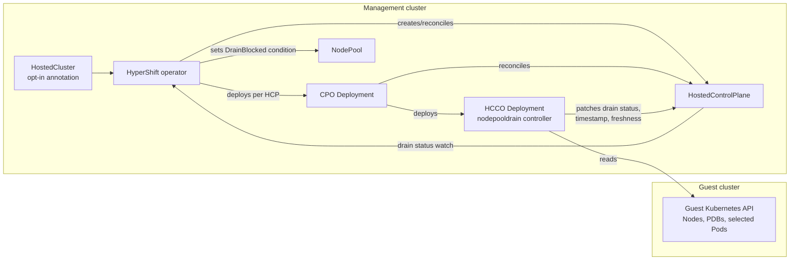

# MCS-1421: NodePool drain readiness architecture

**Scope:** Architecture and state contract of the HyperShift proof of concept on branch `mcs-1421-nodepool-drain-readiness` ([PR #10165](https://github.com/openshift/hypershift/pull/10165), implementation tip `e94fe91f30`). This note describes the code in this branch; fleet-side upgrade enforcement is a separate integration.

## The explanation in one minute

A worker upgrade eventually drains a node. Kubernetes may reject a Pod eviction when a PodDisruptionBudget (PDB) requires every replica to remain available. The upgrade can then wait for a disruption that the workload cannot permit. MCS-1421 adds an **advisory status signal** that identifies this structural case before a drain starts.

The Hosted Cluster Config Operator (HCCO) already has access to the guest Kubernetes API. Its new `nodepooldrain` controller scans guest Nodes, customer PDBs, and matching Pods. It publishes a small per-pool result on the HostedControlPlane (HCP). The shared HyperShift operator reads that result and sets a `DrainBlocked` condition on each NodePool. This code does **not** pause an upgrade or call the eviction API. A future consumer can use the condition in its upgrade policy.

The main distinction to explain is that there are **three state-bearing pieces**, with different meanings:

1. HCCO computes `Blocked` or `Drainable` for each pool it can identify from guest Node labels.
2. The HCP `NodePoolDrainUpToDate` condition and probe timestamp say whether that computation can be trusted as current.
3. The NodePool controller combines both into `DrainBlocked=True`, `False`, or `Unknown`.

## Components and data path

| Term | Role in this change |
| --- | --- |
| HostedCluster (HC) | Management-cluster API object representing a hosted cluster; carries the opt-in annotation. |
| HostedControlPlane (HCP) | Management-cluster API object for one hosted control plane; stores the probe's compact result, timestamp, and freshness condition. |
| NodePool | Management-cluster API object for a set of worker nodes; exposes the final `DrainBlocked` condition. |
| HyperShift operator (HO) | Shared management-cluster operator; deploys the per-cluster operators and reconciles NodePool status. |
| Control Plane Operator (CPO) | Per-HCP Deployment that reconciles control-plane components and deploys HCCO. Its image normally comes from the OpenShift release payload. |
| Hosted Cluster Config Operator (HCCO) | Separate per-HCP Deployment/binary in the CPO image; has guest API access and runs the new probe. |
| Guest cluster | Kubernetes API containing the worker Nodes, workload Pods, and PDBs examined by the probe. |



This path keeps guest reads inside an existing per-cluster operator. Only pool names, states, reason codes, and PDB counts cross into HCP/NodePool status. The guest PDB Event contains the PDB name for local diagnosis.

## Status contract: what the states mean

HCCO writes `status.nodePoolDrain[]` on the HCP. Each entry contains `nodePoolName`, a required `state` (`Blocked` or `Drainable`), an optional `blockingCount`, and an optional bounded `reason`. The array is keyed by pool name in the CRD. HCCO also writes `status.nodePoolDrainLastProbeTime` after a complete scan and sets HCP condition `NodePoolDrainUpToDate=True`. Entries exist only for pools found on guest Nodes labeled `hypershift.openshift.io/nodePool`; an absent entry is unverified, not clear.

An illustrative HCP status fragment:

```yaml
status:
  nodePoolDrain:
    - nodePoolName: workers-a
      state: Blocked
      blockingCount: 1
      reason: BlockedByPodDisruptionBudget
  nodePoolDrainLastProbeTime: "2026-10-30T12:00:00Z"
  conditions:
    - type: NodePoolDrainUpToDate
      status: "True"
      reason: AsExpected
```

This entry in `status.conditions` describes the **freshness of the probe**, not whether `workers-a` is blocked:

- `type: NodePoolDrainUpToDate` names the condition. It tells consumers whether HCCO has recently computed the per-pool results from the guest cluster.
- `status: "True"` means the latest probe completed and HCCO published its result. `False` means the result is not currently verified; for example, HCCO uses `PodScanIncomplete` when a matching Pod list exceeds the safety limit and `GuestUnreachable` after guest reads have failed past the grace period.
- `reason: AsExpected` is the short success reason for a completed probe. It does not mean every NodePool is drainable.

To interpret `workers-a`, read its `state` in `status.nodePoolDrain[]`. The NodePool controller also checks that the probe timestamp is present and no more than 15 minutes old. So `NodePoolDrainUpToDate=True` by itself is not enough to treat an old result as current.

The NodePool controller makes this translation:

| HCP input for this pool | NodePool `DrainBlocked` | Reason | Meaning |
| --- | --- | --- | --- |
| Fresh successful probe, `state=Blocked` | `True` | `BlockedByPodDisruptionBudget` | At least one structural customer PDB applies to a drain candidate Pod on a node in this pool. Message contains the PDB count. |
| Fresh successful probe, `state=Drainable` | `False` | `Drainable` | This scan found no structural PDB blocker for the pool. It does not guarantee that every drain will succeed. |
| Freshness missing/false, invalid or expired timestamp, absent pool entry, or absent/unsupported state | `Unknown` | `Unverified`, or `Stale` for an expired timestamp | No current, interpretable result. An enforcement consumer should fail open. |
| Feature disabled | Condition removed | — | The signal is no longer offered for this cluster. |

“Fresh” requires `NodePoolDrainUpToDate=True`, a nonzero probe timestamp no more than 15 minutes old, and a timestamp no more than one minute in the future. A fresh `Blocked` or `Drainable` result schedules a NodePool reconcile at its 15-minute expiry. This recheck survives early returns from later NodePool validation. While the NodePool controller continues reconciling, a stopped HCCO writer therefore cannot leave a known condition in place indefinitely. Older HCP status with the former `blocked` boolean deserializes without `state` and becomes `Unknown`.

The NodePool condition is a projection of HCCO's observation, not a separate probe. `True` means **drain blocked**; `False` means **no structural blocker found**. The state transition model is:

```text
                      complete successful probe
       Unknown --------------------------------------> True or False
         ^                                                |       |
         | incomplete scan, stale data, missing data      |       |
         +------------------------------------------------+-------+
                   successful re-probe can switch True <-> False
                   disabling the feature removes the condition
```

| Trigger | HCP freshness and stored result | NodePool transition |
| --- | --- | --- |
| Complete successful scan | Write a new array and probe time; set `NodePoolDrainUpToDate=True`. | `True` or `False` according to this pool's new state; `Unknown` if the pool has no entry. |
| PDB or Pod placement changes | Next watch-triggered or one-minute probe replaces the result. | Can move between `True` and `False`. |
| Pod scan exceeds the per-PDB limit | Keep the old array/time; set freshness `False` immediately. | Move to `Unknown` (`Unverified`). |
| Guest read fails briefly | Keep the old array/time and previous freshness condition. | Retain a known state only while the stored time remains fresh. |
| No successful refresh for 15 minutes | HCCO eventually marks freshness `False` on read errors; the stored time also expires independently. | Move to `Unknown` (`Stale` when age is the deciding check). |
| Opt-in removed | Per-cluster probe disabled; stored HCP fields may remain. | Remove `DrainBlocked`. |

## How one HCCO probe decides

The probe deliberately targets **structural** blockers: PDBs that would allow zero voluntary disruptions even if every expected Pod were healthy. This reduces false alarms from short-lived PDB pressure, at the cost of missing some temporary drain delays.

```text
1. List guest Nodes and build node name -> NodePool name from the NodePool label.
2. List guest PDBs. Skip platform namespaces and PDBs unless:
      status.expectedPods >= 1 AND status.desiredHealthy >= status.expectedPods
3. For each remaining PDB, list matching Pods in its namespace using its selector.
4. Skip Pods that the drain would not evict; map each remaining Pod's node to a pool.
5. Count each PDB once per affected pool, even if it matches several Pods there.
6. Publish a sorted Blocked/Drainable entry for every pool seen in step 1.
```

The selector and Pod checks matter:

- A `nil` PDB selector matches nothing; an empty `{}` selector matches all Pods in that namespace.
- Unscheduled, completed, mirror/static, and DaemonSet-owned Pods are excluded because this drain path does not evict them. Pending Pods are also excluded as blockers because they can be evicted.
- For `unhealthyPodEvictionPolicy: AlwaysAllow`, an **unready Running Pod** can be evicted despite a zero budget, so it is excluded as a blocker. A Ready Pod remains protected by that PDB.
- Platform namespaces are excluded by default for prefixes `openshift-` and `kube-`, plus exact `openshift` and `kube-system`. The `default` namespace is included. A deployment can add prefixes with `NODEPOOL_DRAIN_ADDITIONAL_PLATFORM_NAMESPACE_PREFIXES`.

For example, a one-replica workload with `minAvailable: 1`, one Ready Pod on a labeled worker, and PDB status `expectedPods=1, desiredHealthy=1` yields `Blocked` for that worker's pool. If the Pod is unready and the PDB sets `AlwaysAllow`, the same structural PDB yields `Drainable` for that pool when no other blocker exists. With two healthy replicas and `minAvailable: 1`, `desiredHealthy < expectedPods`, so this structural check does not flag the PDB. Current health or other drain failures can still delay eviction.

## Reconciliation, failure, and freshness

HCCO watches guest Nodes for create/delete and NodePool-label changes, and watches PDBs. Node heartbeat updates do not trigger a probe. Pods are read through an **uncached**, server-side filtered API reader, so there is no cluster-wide Pod informer. A successful probe schedules another scan after one minute; this catches Pod placement changes that have no Pod watch.

Each matching Pod list is limited to 2,000 Pods **per PDB**. A continuation token or an over-limit list makes the entire scan incomplete. The controller does not publish partial `Drainable` results. It sets HCP `NodePoolDrainUpToDate=False` with reason `PodScanIncomplete`, clears current blocked metrics, and retries in one minute. The old array and timestamp remain stored, but the NodePool controller treats them as `Unknown` because the freshness condition is false.

For a generic guest-read error, HCCO retains the last HCP result during a 15-minute grace window and returns an error for controller-runtime retry. Its in-memory `lastSuccess` clock is seeded on process start, so a startup error does not instantly mark the condition false. If failures continue past the grace window, HCCO sets `NodePoolDrainUpToDate=False` with reason `GuestUnreachable` and clears blocked metrics. Independently, the NodePool controller expires the persisted probe timestamp at 15 minutes. This also covers a stopped or restarted writer and failures to publish HCP status.

On a complete scan, HCCO patches the HCP array and timestamp, then the HCP freshness condition, using the shared optimistic status-patching helper. The HyperShift operator watches drain-specific HCP status changes, maps the HCP to its NodePools, and updates each condition. The HCP watcher ignores unrelated status updates. `Unknown` is the safe interpretation of any missing, stale, or unsupported value; this POC's HyperShift code does not enforce an upgrade gate.

## Activation and rollback

Two controls must both be present:

1. Set `ENABLE_NODEPOOL_DRAIN_READINESS=1` on the shared HyperShift operator Deployment. This enables the capability and the HCP status watch.
2. Annotate a trial HostedCluster with `hypershift.openshift.io/enable-nodepool-drain-readiness=true`. HyperShift mirrors the annotation to HCP, and CPO propagates the flag to that cluster's HCCO Deployment.

For this branch POC, the trial HostedCluster also needs `hypershift.openshift.io/control-plane-operator-image=<branch-cpo-image>` so its CPO/HCCO image includes the new controller; the normal CPO image comes from the OpenShift release payload. Removing the opt-in annotation disables the per-cluster probe and removes the NodePool `DrainBlocked` condition. Existing HCP status may remain stored but is no longer consumed. The change only updates status and operator configuration; it does not add a NodePool config-hash input or initiate a worker rollout.

## What SREs can observe

| Surface | What it shows | Limitation |
| --- | --- | --- |
| NodePool `DrainBlocked` condition | `True`, `False`, or `Unknown`, reason, and count-only message | No PDB or Pod identifier. |
| HCP drain status, timestamp, and `NodePoolDrainUpToDate` | Raw per-pool result and whether it is current | Old array may remain after a failed scan; check freshness and timestamp together. |
| Guest PDB Warning Event `DrainBlocked` | Newly observed PDB-to-pool block, with the PDB name and pool | Transition tracking is in memory; an HCCO restart can emit it again. |
| `hypershift_nodepool_drain_blocked{namespace,nodepool}` | Sparse series with value `1` only for currently blocked pools | Series is removed on clear or stale/incomplete scan. |
| `hypershift_nodepool_drain_uptodate{namespace}` | `1` after success, `0` when HCCO marks stale/incomplete | A transient read error inside the grace window retains the prior value; use the timestamp for age. |

For a live explanation, inspect both sides of the projection:

```sh
kubectl -n <hcp-namespace> get hostedcontrolplane <hcp-name> -o json \
  | jq '{drain: .status.nodePoolDrain, probed: .status.nodePoolDrainLastProbeTime,
         freshness: [.status.conditions[]? | select(.type == "NodePoolDrainUpToDate")]}'
kubectl -n <hc-namespace> get nodepool <nodepool-name> -o json \
  | jq '.status.conditions[]? | select(.type == "DrainBlocked")'
```

## POC boundaries and validation to discuss

- This is a prediction from PDB status and current Pod placement. PDB status itself can lag. The probe does not request eviction or guarantee that a later drain succeeds. Workload scaling, Pod movement, PDB edits, and other drain failures can change the outcome between probes.
- The 2,000-Pod bound is per PDB. A cluster with many structural PDBs can still cause many filtered Pod lists. Measure guest API requests, HCCO memory/CPU, and reconcile duration before broader enablement.
- The HCP status schema allows at most 500 per-pool entries. A probe that cannot be published must age out to `Unknown`; validate this limit against target fleet shapes.
- No alert rule, runbook, or fleet-side enforcement is shipped by this HyperShift POC. The downstream consumer must treat `Unknown` as fail open and define its own policy and override path before enforcement.
- POC precision cases should include: Ready Pod with a zero budget (`True`); unready Running Pod with `AlwaysAllow` (`False` if no other blocker); Pending/DaemonSet/mirror/completed Pods; a PDB with healthy disruption headroom; a Pod moved to another pool; an over-limit Pod list (`Unknown`); and lost guest access followed by timestamp expiry (`Unknown`). Measure false blocks and missed structural blockers against actual eviction outcomes in a trial cluster.

## Code map

| Concern | Primary code |
| --- | --- |
| API types and HCP fields | [`api/hypershift/v1beta1/nodepooldrain_types.go`](api/hypershift/v1beta1/nodepooldrain_types.go), [`hosted_controlplane.go`](api/hypershift/v1beta1/hosted_controlplane.go), [`nodepool_conditions.go`](api/hypershift/v1beta1/nodepool_conditions.go) |
| Guest watch registration | [`control-plane-operator/hostedclusterconfigoperator/controllers/nodepooldrain/setup.go`](control-plane-operator/hostedclusterconfigoperator/controllers/nodepooldrain/setup.go) |
| Scan, HCP writes, Events, metrics | [`control-plane-operator/hostedclusterconfigoperator/controllers/nodepooldrain/nodepooldrain.go`](control-plane-operator/hostedclusterconfigoperator/controllers/nodepooldrain/nodepooldrain.go) |
| Structural and Pod eviction predicates | [`support/pdbdrain/pdbdrain.go`](support/pdbdrain/pdbdrain.go) |
| NodePool condition translation and HCP watch | [`hypershift-operator/controllers/nodepool/conditions.go`](hypershift-operator/controllers/nodepool/conditions.go), [`nodepool_controller.go`](hypershift-operator/controllers/nodepool/nodepool_controller.go) |
| Operational enablement note | [`control-plane-operator/hostedclusterconfigoperator/controllers/nodepooldrain/README.md`](control-plane-operator/hostedclusterconfigoperator/controllers/nodepooldrain/README.md) |

**Suggested closing line:** “We added an advisory observation in HCCO and a freshness-aware NodePool condition. A verified structural PDB blocker is `True`, a verified clear scan is `False`, and anything we cannot verify is `Unknown`.”
