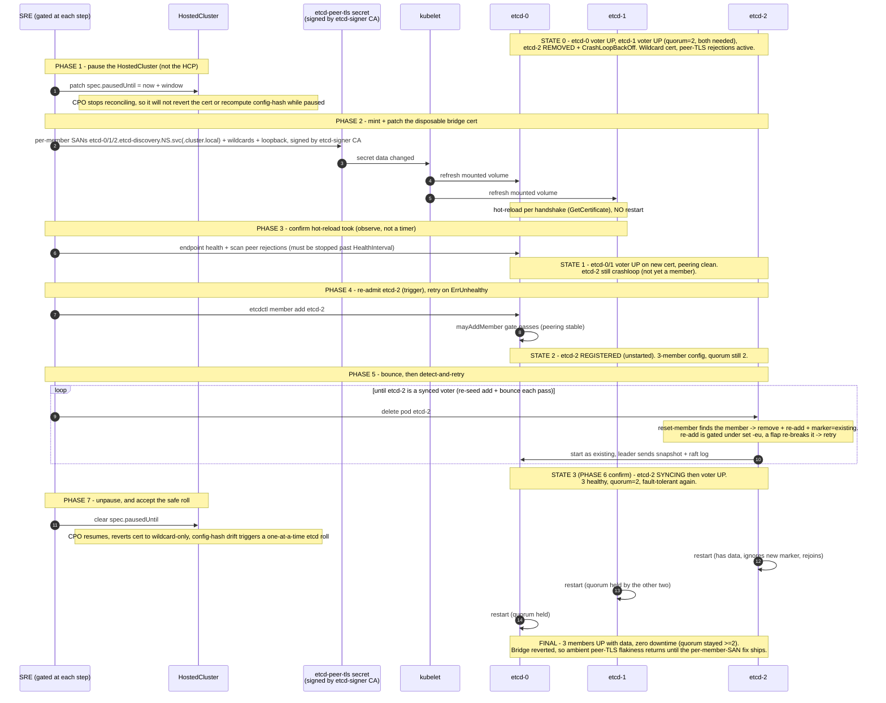

# etcd-sanfix

Break-glass recovery for a HyperShift hosted etcd cluster stuck on the peer-cert SAN bug: one
member has been removed and crash-loops, unable to rejoin, because the etcd peer cert carries only
wildcard SANs and peer TLS rejects a dialer whose pod IP reverse-resolves to the ambiguous
`etcd-client` PTR first (`rejected connection on peer endpoint ... does not match any of DNSNames`).

**This is a throwaway, SRE-run tool.** It heals the cluster back to 3 healthy voters with zero
downtime during the heal, then you unpause and accept a one-time, safe rolling restart. It does
**not** cure the cert bug: the bridge cert is reverted by the CPO at unpause, so ambient peer-TLS
flakiness returns until the durable per-member-SAN fix ships.

## Subcommands

It is a parent command on the `hypershift` CLI. Point `KUBECONFIG` at the management cluster; it
runs from your workstation and works out how to reach etcd itself (see **Modes** below).

| Command | Mutates? | What it does |
|---------|----------|--------------|
| `heal` | yes (gated) | the guided recovery: pause, bridge cert, re-admit, bounce, unpause |
| `cert` | no | inspect `etcd-peer-tls`: SANs, expiry, and whether it is wildcard-only or bridged |
| `health` | no | member list, per-endpoint health, leader, db size, alarms |
| `preflight` | no | before-checks: is this the SAN-bug situation, and is healing safe? |
| `verify` | no | after-checks: are all members back, healthy, and fault-tolerant? |

The four read-only subcommands are safe to run any time. The typical flow is `preflight` to confirm
the situation, `heal` to recover, `verify` to confirm. Every subcommand takes `--namespace` (the
hosted control plane namespace).

## Modes

Every subcommand auto-detects how to reach etcd:

- **Out-of-cluster (default on a workstation):** when the in-pod cert files are absent, it reads the
  etcd CA and client cert from the cluster secrets and port-forwards to the etcd pods itself. No
  manual `oc port-forward`, no cert extraction, so `health` / `preflight` / `verify` work from your
  laptop with just `--namespace`.
- **In-cluster (default inside an etcd pod):** when the in-pod cert files are present, it dials the
  etcd service DNS directly with them.

Force out-of-cluster with `--local`; pass a specific `--etcd-endpoint` to route directly. `cert` only
ever needs `KUBECONFIG` (it reads the secret through the kube API and never talks to etcd).

## heal

```
hypershift etcd-sanfix heal --namespace <hcp-namespace> --hosted-cluster <ns>/<name>
```

It is **guided and gated**: at every state change it shows what it observed, prints the commands
you can run to confirm the same reality, and waits for you to type a confirmation token
(`PAUSE`, `PATCH-CERT`, `MEMBER-ADD`, `BOUNCE`, `UNPAUSE`) before it acts. A mismatch between what
it shows and what you see is itself a stop signal.

Non-core steps are skippable if you would rather do them by hand:

| Flag | Meaning |
|------|---------|
| `--skip-pause` | you paused the HostedCluster yourself |
| `--skip-bounce` | you will `oc delete pod <member>` yourself |
| `--skip-unpause` | you will clear `spec.pausedUntil` yourself |

Other flags: `--member` (stuck member, auto-detected by default), `--etcd-endpoint` (override for a
port-forward; defaults to the in-cluster `etcd-client` service), `--etcd-ca-cert` /
`--etcd-client-cert` / `--etcd-client-key` (in-pod defaults), `--max-retries` (default 5),
`--pause-window` (default 2h).

## Inspect and check

```
hypershift etcd-sanfix preflight --namespace <hcp-namespace>   # safe to run before heal
hypershift etcd-sanfix cert      --namespace <hcp-namespace>   # SANs + wildcard-only/bridged verdict
hypershift etcd-sanfix health    --namespace <hcp-namespace>   # members, health, leader, alarms
hypershift etcd-sanfix verify    --namespace <hcp-namespace>   # safe to run after heal
```

`preflight` and `verify` exit non-zero on a failing verdict (`NO-GO` / `NOT-RECOVERED`), so you can
gate a script on them. `cert` classifies the peer cert as `WILDCARD-ONLY` (the bug), `BRIDGED` (has
the per-member SANs), or `PARTIAL`.

## Recovery sequence



## Guardrails

- Never restarts a healthy member; the only pod bounced is the stuck one, which is already down.
- Aborts if fewer than 2 members are registered/healthy (no safe recovery state).
- Pauses the **HostedCluster**; the HCP pause is overwritten by the hypershift-operator.
- At unpause the CPO reverts the bridge cert and rolls etcd one pod at a time; that roll is safe
  only once all 3 members are healthy, which is why the tool reaches 3/3 before unpausing.
- On failure it leaves the cluster paused and prints where it stopped; it never auto-unpauses.

Full rationale, the adversarial-review corrections, and the honest invariants are in the design
note `hcp-etcd-sanfix plan.md`.
