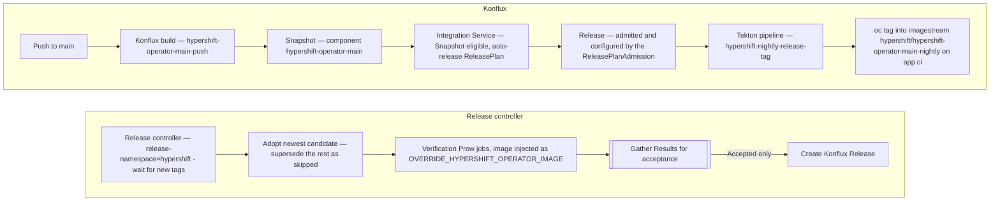

# HyperShift Operator Nightly Releases

The HyperShift Operator built from `main` is published as a **nightly release
stream**, gated by the same
[OpenShift release controller](https://github.com/openshift/release-controller)
that accepts and rejects OCP nightly payloads. Each nightly is a Konflux-built
operator image that has been tagged into a CI imagestream and offered to the
controller as a release candidate.

Browse the stream at
**[hcp.releases.ci.openshift.org](https://hcp.releases.ci.openshift.org)**.

The stream gives you:

- The Konflux-built pull spec for each candidate, and the verification status
  the controller reached for it.
- A changelog between any two nightlies, rendered from the commits that went
  into them.

!!! important "Use an `Accepted` nightly"

    Not every tag in the stream is a tested image. The controller runs one
    release cycle at a time (see [cadence](#4-the-release-controller-picks-up-the-tag)):
    when it is ready it adopts the most recently imported candidate and marks
    the candidates it superseded **skipped**, giving them no phase and no
    verification jobs. An adopted candidate can also still be pending, or have
    failed verification.

    When you need an image that passed the blocking gate, pick a release the
    controller marked `Accepted`.

## How it works



### 1. Konflux builds the operator

A push to `main` triggers
[`.tekton/hypershift-operator-main-push.yaml`](https://github.com/openshift/hypershift/blob/main/.tekton/hypershift-operator-main-push.yaml),
which runs the shared
[`common-operator-build`](https://github.com/openshift/hypershift/blob/main/.tekton/pipelines/common-operator-build.yaml)
pipeline and pushes
[`quay.io/redhat-user-workloads/crt-redhat-acm-tenant/hypershift-operator/hypershift-operator-main`](https://quay.io/repository/redhat-user-workloads/crt-redhat-acm-tenant/hypershift-operator/hypershift-operator-main?tab=tags)`:<revision>`.

The build bakes `/release-manifests/image-references` into the image — see
[Changelogs](#changelogs-and-the-release-manifests-contract).

### 2. Konflux creates a Snapshot and a Release

Konflux's
[Integration Service](https://github.com/konflux-ci/integration-service)
creates a **Snapshot** describing the built components, then creates a
**Release** for it against each auto-release-enabled **ReleasePlan** for the
application. Two separate things have to hold:

- The **Snapshot must be eligible** — its required integration tests have
  finished and passed, it is valid, it came from a push (not a pull request)
  and it is not a group snapshot or labelled `auto-release: "false"`.
- A **ReleasePlan** in `crt-redhat-acm-tenant` must have auto-release enabled
  (the `release.appstudio.openshift.io/auto-release` label is `"true"` or
  absent).

The **ReleasePlanAdmission** (RPA) is the managed-side counterpart: it admits
the ReleasePlan, names the pipeline to run, and carries the release
configuration. It is not what creates the Release, so when a Release is
missing, check the ReleasePlan and the Snapshot's eligibility first.

The RPA is where per-component tagging config lives:

```yaml
spec:
  data:
    mapping:
      components:
      - name: hypershift-operator-main                     # must match the Snapshot component
        destination-imagestream: hypershift/hypershift-operator-main-nightly
        release-version: "0.0.1"                           # optional, see below
```

!!! warning "Component names must match exactly"

    The `apply-mapping` task deep-merges `mapping.components[]` into the
    Snapshot components **by name**, keeping only the names present in both. A
    mapping entry whose name is not in the Snapshot — or a Snapshot component
    not in the mapping — is dropped silently, so a *partial* mismatch quietly
    narrows what gets tagged while the release still succeeds.

    A *total* mismatch is caught: this pipeline passes
    [`failOnEmptyResult: "true"`](https://github.com/openshift/hypershift/blob/main/.tekton/pipelines/nightly-release-tag.yaml),
    so zero matching names fails the `apply-mapping` task with
    `ERROR: Resulting snapshot contains 0 components...`, before `tag-image`
    runs at all.

### 3. The tag pipeline runs

The Release runs
[`.tekton/pipelines/nightly-release-tag.yaml`](https://github.com/openshift/hypershift/blob/main/.tekton/pipelines/nightly-release-tag.yaml)
(`hypershift-nightly-release-tag`), which:

1. [`verify-access-to-resources`](https://github.com/konflux-ci/release-service-catalog/blob/production/tasks/managed/verify-access-to-resources/verify-access-to-resources.yaml)
   — checks the pipeline can read the release CRs.
2. [`collect-data`](https://github.com/konflux-ci/release-service-catalog/blob/production/tasks/managed/collect-data/collect-data.yaml)
   — merges `spec.data` from the Release, ReleasePlan and RPA into `data.json`.
3. [`apply-mapping`](https://github.com/konflux-ci/release-service-catalog/blob/production/tasks/managed/apply-mapping/apply-mapping.yaml)
   — merges the mapping into the Snapshot components, failing the release if
   nothing matches.
4. `tag-image` — computes a tag per component and runs `oc tag` against the CI
   cluster. Defined inline in the pipeline above, not in the catalog.

`tag-image` authenticates to app.ci with a kubeconfig from the
`hypershift-ci-cluster-credentials` secret, mounted at `/credentials/kubeconfig`.

### 4. The release controller picks up the tag

A dedicated release controller instance
([`deploy-hypershift-controller.yaml`](https://github.com/openshift/release/blob/main/clusters/app.ci/release-controller/deploy-hypershift-controller.yaml))
runs on app.ci with `--release-namespace=hypershift`, watching the
`hypershift-operator-main-nightly` imagestream. Its configuration is annotated
onto that imagestream from `openshift/release` — see
[Configuration](#configuration).

When the controller is ready to start a cycle it **adopts** the most recently
imported tag, marks any candidate it superseded as skipped, launches the
verification Prow jobs for the adopted one, and moves it to `Accepted` or
`Rejected`. 

!!! note "Cadence"

    The release controller is configured with a minimum 4 hour interval between releases to prevent overwhelming the CI cluster.
    If you need to release more frequently, decrease the `minCreationIntervalSeconds` field in the release controller config.
    ```json
    "minCreationIntervalSeconds": 14400
    ```
    A nightly still under verification also blocks the next one, so you may need to raise `maxUnreadyReleases` to allow more
    concurrent releases.
    ```json
    "maxUnreadyReleases": 2
    ```

## How a nightly gets its name

A nightly tag is a version plus a semver pre-release segment:

```
0.1.86-148-g0bb9d28005.nightly-2026-10-02-174500
└───── version ──────┘ └─── nightly segment ───┘
```

### The version

Either the RPA's `release-version` for that component, or — when it is omitted
— derived by running `git describe --tags` against the component's
`source.git.revision`.

!!! tip

    `source.git.revision` is **the commit the image was built from**.
    A leading `v` is stripped, because this repository's tags are
    `v`-prefixed but imagestream tags are built from a bare version.

### The timestamp

`<ts>` is **the time the release pipeline ran**. `tag-image` takes it once per
run with `date -u`, so every component tagged by one Release shares a
timestamp.

!!! warning "A tag does not identify a revision"

    Because the timestamp comes from the run rather than from the commit, two
    Releases of the *same* revision produce two differently named tags whenever
    their timestamps differ. The pipeline does not check whether the revision
    Releases of the *same* revision — a retry, or one of the rebuilds Konflux
    performs whenever a base image moves — produce two differently named tags
    pointing at different images. The pipeline does not check whether the
    revision has already been tagged, so neither release is suppressed.

    If you are trying to work out which commit a nightly came from, read the
    `io.openshift.build.commit.id` annotation on the image rather than inferring
    it from the tag.

## Changelogs and the `release-manifests` contract

`oc adm release info --changelog` is payload-only: it extracts
`release-manifests/image-references` from the image's **topmost layer** and
errors out when the file is absent. The HyperShift Operator image is not a
payload, so the build fakes a minimal one-tag ImageStream to satisfy it.

[`release-manifests/image-references.template.yaml`](https://github.com/openshift/hypershift/blob/main/release-manifests/image-references.template.yaml)
is rendered by
[`Containerfile.operator`](https://github.com/openshift/hypershift/blob/main/Containerfile.operator)
from three build args, wired up in
[`.tekton/pipelines/common-operator-build.yaml`](https://github.com/openshift/hypershift/blob/main/.tekton/pipelines/common-operator-build.yaml):

| Build arg | Source | Used for |
|---|---|---|
| `COMMIT_HASH` | `clone-repository` task's `commit` result | `io.openshift.build.commit.id` — the endpoint of the commit range `oc` diffs |
| `RELEASE_IMAGE_REFERENCE` | the pipeline's `output-image` param | the tag's `from.name` |
| `SOURCE_DATE_EPOCH` | `clone-repository` task's commit-timestamp result | `metadata.creationTimestamp`, the `Created` header |

`oc` generates the changelog entirely from the `io.openshift.build.*`
annotations: it clones `source-location` and runs `git log` over the range
between the two builds' `commit.id` values. A single tag naming this repository
is therefore enough.

## Configuration

Configuration is spread across this repository, `openshift/release` and the
Konflux tenant namespace. Find the row for what you want to change:

| I want to change… | Where | Who approves |
|---|---|---|
| Which e2e jobs gate a nightly, blocking vs informing, retries, expiry, release cadence | `openshift/release` → [`_releases/hypershift/release-hcp-main.json`](https://github.com/openshift/release/blob/main/core-services/release-controller/_releases/hypershift/release-hcp-main.json) | **HyperShift team** (self-serve) |
| Who can approve the above | the [`OWNERS`](https://github.com/openshift/release/blob/main/core-services/release-controller/_releases/hypershift/OWNERS) file alongside it | HyperShift team |
| How the controller itself is deployed | `openshift/release` → [`clusters/app.ci/release-controller/deploy-hypershift-controller.yaml`](https://github.com/openshift/release/blob/main/clusters/app.ci/release-controller/deploy-hypershift-controller.yaml) | ART/CRT |
| Tag computation, catalog pin, credentials secret name | this repo → [`.tekton/pipelines/nightly-release-tag.yaml`](https://github.com/openshift/hypershift/blob/main/.tekton/pipelines/nightly-release-tag.yaml) | HyperShift team |
| Changelog metadata baked into the image | this repo → [`Containerfile.operator`](https://github.com/openshift/hypershift/blob/main/Containerfile.operator), [`release-manifests/image-references.template.yaml`](https://github.com/openshift/hypershift/blob/main/release-manifests/image-references.template.yaml), [`.tekton/pipelines/common-operator-build.yaml`](https://github.com/openshift/hypershift/blob/main/.tekton/pipelines/common-operator-build.yaml) | HyperShift team |
| Component mapping, destination imagestream, release version, EC policy, pipeline ref | the `ReleasePlanAdmission` in the `crt-redhat-acm-tenant` Konflux namespace | see [Konflux resources](#konflux-resources) |
| Auto-release on/off | the `ReleasePlan` in `crt-redhat-acm-tenant` | see [Konflux resources](#konflux-resources) |
| CI cluster credentials, trusted-artifacts push secret | secrets in `crt-redhat-acm-tenant` | see [Konflux resources](#konflux-resources) |

### Release controller config

[`release-hcp-main.json`](https://github.com/openshift/release/blob/main/core-services/release-controller/_releases/hypershift/release-hcp-main.json)
is annotated onto the imagestream by
[`hack/annotate.sh`](https://github.com/openshift/release/blob/main/hack/annotate.sh)
in `openshift/release`:

```bash
annotate "hypershift" "hypershift-operator-main-nightly" "hcp-main.json" "hypershift"
```

The fifth argument is the subdirectory under `_releases/`.

The fields in [`release-hcp-main.json`](https://github.com/openshift/release/blob/main/core-services/release-controller/_releases/hypershift/release-hcp-main.json)worth knowing:

| Field | Current value | Effect |
|---|---|---|
| `as` | `Layered` | The tag is the image, not a payload. Disables payload-only behaviour such as node image info. |
| `layeredImageEnvVar` | `OVERRIDE_HYPERSHIFT_OPERATOR_IMAGE` | The env var the image is injected into for verify jobs. Can be overridden per-job. |
| `changelogGeneration` | `FromImageReferences` | Must be set explicitly; `Layered` defaults to `Disabled`. |
| `maxUnreadyReleases` | `1` | No new release while one is still being verified. |
| `minCreationIntervalSeconds` | `14400` | At most one release per 4 hours (≈ maximum 6/day - subject to merges to main creating tags).|
| `expires` | `672h` | Age-based pruning for `Accepted` tags: once more than five exist, those older than 28 days become eligible for removal. The five newest `Accepted` tags are always kept, however old. `Failed` and `Rejected` tags are pruned by separate count-based rules ([sync logic](https://github.com/openshift/release-controller/blob/main/cmd/release-controller/sync.go)). |
| `mirrorPrefix` | `hypershift-latest` | Prefix for the mirror imagestream. |
| `referenceMode` | `source` | Keep the originating pull spec rather than copying images. |
| `verify` | a map of job names | The gate. See below. |

A `verify` entry looks like:

```json
"release-5.1-e2e-aks": {
    "maxRetries": 2,
    "prowJob": {
        "name": "periodic-ci-openshift-hypershift-release-5.1-periodics-e2e-aks"
    }
}
```

The key is a label of your choosing; `prowJob.name` must match an existing Prow
job exactly. Job names are generated rather than hand-written, so look them up
in `openshift/release` rather than constructing them:

| Looking for | Where |
|---|---|
| The exact strings to paste into `verify` | [`ci-operator/jobs/openshift/hypershift/openshift-hypershift-release-5.1-periodics.yaml`](https://github.com/openshift/release/blob/main/ci-operator/jobs/openshift/hypershift/openshift-hypershift-release-5.1-periodics.yaml) — one generated file per branch, holding every periodic for that branch. Swap `release-5.1` for `main` or another release branch. |
| What a job runs, and which workflow it uses | the ci-operator config it is generated from: [`openshift-hypershift-release-5.1__periodics.yaml`](https://github.com/openshift/release/blob/main/ci-operator/config/openshift/hypershift/openshift-hypershift-release-5.1__periodics.yaml) and its `__periodics-*` siblings |
| Recent runs and pass rate | [prow.ci.openshift.org](https://prow.ci.openshift.org/?type=periodic&job=*hypershift*) |

Names are assembled as `periodic-ci-<org>-<repo>-<branch>-<variant>-<test>`,
where `<variant>` is the `__suffix` on the ci-operator config filename and
`<test>` is the test's `as` field. So
`periodic-ci-openshift-hypershift-release-5.1-periodics-hcm-azure-e2e-aks-upgrade-minor`
is the test `e2e-aks-upgrade-minor` from
`openshift-hypershift-release-5.1__periodics-hcm-azure.yaml`. Every variant for
a branch still lands in that branch's single generated periodics file.

Add `"optional": true` to make a job informing — it runs and is reported, but
does not block acceptance. **New jobs should always start optional** and be
promoted to blocking once they have proven stable against the stream.

Currently, jobs from the latest release branch are blocking with retries,
and jobs from older branches run as informing back-compatibility signal.
This configuration is arbitrary and may change in the future.


### How verification jobs consume the image

The controller injects the nightly's pull spec into
`OVERRIDE_HYPERSHIFT_OPERATOR_IMAGE`, which is read by the
[`hypershift-install`](https://steps.ci.openshift.org/reference/hypershift-install)
step-registry ref
([source](https://github.com/openshift/release/tree/main/ci-operator/step-registry/hypershift/install))
in `openshift/release`. The step uses it for both the operator image **and** the
`hcp` CLI, extracted from the same image, bypassing the usual pipeline
ImageStream dependency resolution.

!!! important "Any job you add to the gate must install via `hypershift/install`"

    If a job builds its own operator image instead, it will run happily and
    report green — while testing something other than the nightly under test.
    Check the job's workflow before adding it to `verify`.

Override precedence inside the step, highest first:

1. `OVERRIDE_HYPERSHIFT_OPERATOR_IMAGE`
2. `HO_MULTI`
3. `INSTALL_FROM_LATEST`

Setting more than one logs a warning.

!!! note "The `MULTISTAGE_PARAM_OVERRIDE_` prefix"

    Jobs triggered through Gangway cannot set step parameters directly, so the
    image travels in `MULTISTAGE_PARAM_OVERRIDE_OVERRIDE_HYPERSHIFT_OPERATOR_IMAGE`
    and the install script copies it across at runtime. That double `OVERRIDE`
    is not a typo.

### Konflux resources

The ReleasePlan, the ReleasePlanAdmission and the secrets they depend on
(`hypershift-ci-cluster-credentials`, the trusted-artifacts push credential)
live in the `crt-redhat-acm-tenant` namespace on the
[stone-prd-rh01](https://console-openshift-console.apps.stone-prd-rh01.pg1f.p1.openshiftapps.com/)
Konflux cluster. They are not in this repository — tenant configuration is
managed by MR against
[`konflux-release-data`](https://gitlab.cee.redhat.com/releng/konflux-release-data/-/tree/main/tenants-config/cluster/stone-prd-rh01/tenants/crt-redhat-acm-tenant/hypershift-operator)
— so read the live objects with:

```bash
# If not already logged in
oc login --web https://api.stone-prd-rh01.pg1f.p1.openshiftapps.com:6443

oc get releaseplan,releaseplanadmission -n crt-redhat-acm-tenant -o yaml
```

Builds, Snapshots and Releases for the application are visible in the
[Konflux UI](https://konflux-ui.apps.stone-prd-rh01.pg1f.p1.openshiftapps.com/ns/crt-redhat-acm-tenant/applications/hypershift-operator/activity/pipelineruns).

The RPA also references:

- `policy: hypershift-nightly` — the
  [`EnterpriseContractPolicy`](https://github.com/conforma/crds) named for this
  release. The tagging pipeline itself does not evaluate it: it runs
  `verify-access-to-resources`, `collect-data`, `apply-mapping` and
  `tag-image`, with no EC verification step before `oc tag`. Treat this as a
  policy reference, and confirm where it is evaluated before relying on it as a
  pre-publication gate.
- `serviceAccountName: release-service-account` — needs RBAC to GET
  `release`/`releaseplan`/`releaseplanadmission`/`snapshot`, and a linked quay
  push secret for the trusted-artifacts steps.

## Runbooks

### Add a new e2e job to the gate

1. Find the job's exact name in
   [`ci-operator/jobs/openshift/hypershift/`](https://github.com/openshift/release/tree/main/ci-operator/jobs/openshift/hypershift)
   (see [the `verify` map](#release-controller-config)).
2. Confirm the job installs HyperShift via the
   [`hypershift-install`](https://steps.ci.openshift.org/reference/hypershift-install)
   step-registry ref, by checking the `workflow` it uses in its ci-operator
   config.
3. Open a PR against `openshift/release` adding an entry to the `verify` map in
   [`_releases/hypershift/release-hcp-main.json`](https://github.com/openshift/release/blob/main/core-services/release-controller/_releases/hypershift/release-hcp-main.json),
   with `"optional": true`.
4. Merge it — the HyperShift
   [`OWNERS`](https://github.com/openshift/release/blob/main/core-services/release-controller/_releases/hypershift/OWNERS)
   file means the team can approve this.
5. Watch a few nightlies. Once the job is reliably passing, drop `optional` and
   add `"maxRetries": 2` to make it blocking — bearing in mind that this
   lengthens the critical path for every subsequent nightly.

### A nightly was rejected

1. Open the release in the
   [controller UI](https://hcp.releases.ci.openshift.org) and find the failing
   job.
2. Follow through to the Prow job and its artifacts.
3. Confirm the job actually tested the nightly: the install step logs
   `WARNING: Overriding OPERATOR_IMAGE` with the override pull spec. If it does
   not, the job is not wired to the override and the result is not about this
   nightly.
4. Use the changelog between the last accepted nightly and this one to narrow
   down the commit range.

### No new nightlies have appeared

Work down the chain:

1. **Konflux build** — did the push to `main` build successfully?
2. **Snapshot** — `oc get snapshots -n crt-redhat-acm-tenant`. Is the newest
   one eligible? Check its `AppStudioTestSucceeded` condition; a Snapshot whose
   integration tests have not finished or have failed is never auto-released.
3. **Release** — `oc get releases -n crt-redhat-acm-tenant`. If no Release was
   created, check auto-release on the **ReleasePlan**
   (`oc get releaseplan -n crt-redhat-acm-tenant --show-labels`), then that the
   RPA admits it — `applications` and `origin` must match.
4. **Release pipeline** — check the PipelineRun, and which task failed:
    - `apply-mapping` failing with
      `ERROR: Resulting snapshot contains 0 components...` means no mapping
      entry name matched a Snapshot component.
    - `tag-image` failing with `mapped snapshot contains 0 components` is its
      own defensive guard on the same condition, reached only if
      `apply-mapping` let an empty result through.
    - `tag-image` failing at `oc tag` is usually an expired CI kubeconfig or
      missing RBAC on app.ci.
5. **Cadence** — `minCreationIntervalSeconds: 14400` and
   `maxUnreadyReleases: 1` both legitimately suppress new releases. A nightly
   stuck in verification blocks the next one. Tags that arrived during the
   cooldown are not queued: when the controller next adopts, it takes the
   newest candidate and marks the rest skipped, so a quiet stream and a stream
   full of skipped tags look different and mean different things.

For archived Konflux PipelineRuns and logs, see
[Konflux CI Scripts](konflux-scripts.md).

### Test a tag pipeline change before merging

The pipeline is only exercised by real Releases, so changes are easy to get
wrong. Apply the pipeline to the tenant namespace and drive it with a manual
PipelineRun that points at an existing Release's CRs:

```bash
oc apply -n crt-redhat-acm-tenant -f .tekton/pipelines/nightly-release-tag.yaml
oc get releases -n crt-redhat-acm-tenant       # pick a recent one
oc get release <name> -n crt-redhat-acm-tenant -o yaml   # read its snapshot/releasePlan/RPA refs
```

Then create a PipelineRun supplying the five params release-service would
normally inject, each as `<namespace>/<name>` of a CR that already exists:

```yaml
apiVersion: tekton.dev/v1
kind: PipelineRun
metadata:
  generateName: test-nightly-release-tag-
  # The managed tenant namespace: where the release CRs, the
  # hypershift-ci-cluster-credentials secret and the trusted-ca configmap live.
  namespace: crt-redhat-acm-tenant
spec:
  pipelineRef:
    name: hypershift-nightly-release-tag
  taskRunTemplate:
    # Needs RBAC to read the release CRs below and push to ociStorage.
    serviceAccountName: release-service-account
  params:
  - name: release
    value: crt-redhat-acm-tenant/<release>
  - name: releasePlan
    value: crt-redhat-acm-tenant/<releaseplan>
  - name: releasePlanAdmission
    value: crt-redhat-acm-tenant/<rpa>
  - name: releaseServiceConfig
    value: release-service/<releaseserviceconfig>
  - name: snapshot
    value: crt-redhat-acm-tenant/<snapshot>
  # Pin the catalog for a reproducible run instead of tracking 'production'.
  # - name: catalogGitRevision
  #   value: <commit-sha>
```

!!! warning "Redirect the destination before running this"

    `destination-imagestream` is **not** a pipeline param. `tag-image` reads it
    off each mapped Snapshot component, where `apply-mapping` put it from the
    RPA's `spec.data.mapping.components[]`. Pointing the test run at a scratch
    imagestream therefore means changing it at that source — either by
    referencing a test RPA in the `releasePlanAdmission` param, or by
    temporarily editing the real one:

    ```yaml
    spec:
      data:
        mapping:
          components:
          - name: hypershift-operator-main
            destination-imagestream: <your-namespace>/scratch-nightly   # not hypershift/...
            release-version: "0.0.1"
    ```

    Confirm the effective value in the `apply-mapping` task's output before
    `tag-image` runs: an unchanged RPA means your test run publishes a real
    nightly into `hypershift/hypershift-operator-main-nightly`.

### Manually release a Snapshot

With auto-release enabled on the ReleasePlan this should not normally be
needed. If auto-release is turned off — or the Snapshot was ineligible at the
time and you want to release it anyway — create a `Release` referencing the
Snapshot and the ReleasePlan in `crt-redhat-acm-tenant`.

### Rotate the CI cluster kubeconfig

Replace the `kubeconfig` key in the `hypershift-ci-cluster-credentials` secret
in `crt-redhat-acm-tenant`. The secret name is a pipeline param
(`ci-cluster-credentials-secret`), so a differently-named secret needs the
param changed too — the `ci-cluster-credentials-secret` field in the RPA
mapping is **informational only** and does not select the secret.

## Glossary

| Term | Meaning |
|---|---|
| **app.ci** | The OpenShift CI build cluster that hosts the imagestreams, the release controller and Prow. |
| **Snapshot** | A Konflux CR recording a set of built component images and the git revisions they came from. |
| **ReleasePlan** | A Konflux CR in the tenant namespace requesting that Snapshots be released. Its `release.appstudio.openshift.io/auto-release` label is what makes the Integration Service create Releases automatically. |
| **ReleasePlanAdmission (RPA)** | The managed-side counterpart that admits a ReleasePlan, names the pipeline to run, and carries release configuration in `spec.data`. |
| **Release** | A Konflux CR representing one execution of a release for one Snapshot. |
| **Trusted artifacts** | How Konflux release tasks pass data between steps — as OCI artifacts in `ociStorage` rather than a shared workspace. |
| **Layered stream** | A release controller stream whose tags are ordinary images rather than release payloads. |
| **Enterprise Contract (EC)** | Konflux's policy engine. An RPA names a policy for the releases it admits, but it is only enforced where a pipeline or gate evaluates it — the nightly tagging pipeline does not. |
| **Gangway** | The API used to trigger Prow jobs programmatically. |

## See also

- [HO/CPO Release Process](release-process.md) — the versioned release process,
  distinct from this continuous nightly stream.
- [Konflux CI Scripts](konflux-scripts.md)
- [Custom Images](custom-images.md)
