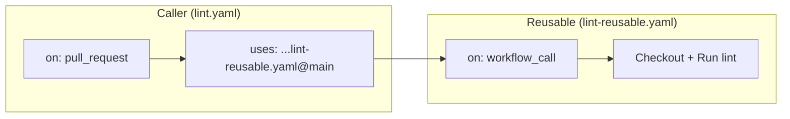

# 🔄 GitHub Actions Workflows

HyperShift uses GitHub Actions for lightweight CI checks that run on every pull request. These workflows complement the heavier Prow-based e2e tests by providing fast feedback on code quality, formatting, and documentation.

## 🏗️ Reusable Workflow Architecture

All GHA workflows follow a **caller + reusable** pattern:

- **Caller workflow** (e.g., `lint.yaml`) — defines triggers (`pull_request`, branch filters) and delegates to a reusable workflow.
- **Reusable workflow** (e.g., `lint-reusable.yaml`) — contains the actual job steps. Triggered via `workflow_call` and optionally on `push` to `main` for post-merge runs.

Callers normally reference the reusable workflow as `owner/repo/.github/workflows/<name>-reusable.yaml@main`. `test.yaml` is the documented exception: it references `./.github/workflows/test-reusable.yaml` so a pull request runs the reusable workflow from its own commit, which is the only way to rehearse a change to it before merging. Note that the unit-test shards still only run when the pull request changes files outside `docs/` and `.github/`, so a pull request that touches only the reusable workflow exercises the workflow structure and the no-tests coverage path, not the Go tests themselves. Changes under `contrib/` do run the shards, because `contrib/` holds executable code that the `other` shard tests.



This pattern provides:

- ✅ **Consistency** — all PR and push workflows share the same job definitions.
- 🔧 **Maintainability** — job logic is defined once in the reusable workflow and updated in a single place.
- 📊 **Coverage reporting** — the unit-test reusable publishes one coverage profile per shard and uploads a single merged report per commit once every shard has succeeded, so Codecov computes its statuses on the complete test run instead of on a partial one.
- 🔒 **Security** — callers reference reusable workflows from `@main`, reducing the risk of a pull request altering reusable job logic. Caller workflows are protected by branch protection rules and CODEOWNERS. `test.yaml` is the documented exception: pull requests from forks never receive repository secrets, but same-repository pull requests do receive them through `secrets: inherit`, so for those the reusable now resolves from the pull request commit. That is why the exception is scoped to `test.yaml` — whose jobs request only `contents: read` — instead of being applied across the workflow set.

## 📋 Workflows

The PR validation workflows run on self-hosted ARC runners. Most target `main` and `release-4.22`; only the OCP and vanilla Kubernetes envtest workflows also target `release-5.0`.

Pull request callers resolve their reusable workflows from `main`, while post-merge runs use the reusable workflow stored on the pushed branch. `test.yaml` is the exception: it references the reusable workflow locally, so a pull request runs the version from its own commit and a change to `test-reusable.yaml` can be rehearsed before merging. Keep branch-local matrices synchronized with `main`; `release-5.0` envtests must include Kubernetes 1.36 for consistent pull request and post-merge coverage.

### 🧹 Code Quality

| Caller | Reusable | Purpose |
|--------|----------|---------|
| `codespell.yaml` | `codespell-reusable.yaml` | Spell checking across the codebase |
| `deadcode.yaml` | `deadcode-reusable.yaml` | Whole-program dead-code analysis; temporarily advisory pending [CNTRLPLANE-4936](https://redhat.atlassian.net/browse/CNTRLPLANE-4936) |
| `gitlint.yaml` | `gitlint-reusable.yaml` | Commit message format validation |
| `lint.yaml` | `lint-reusable.yaml` | Go linting via `golangci-lint` |
| `verify.yaml` | `verify-reusable.yaml` | Full verification (`make verify`) |

### 🧪 Testing

| Caller | Reusable | Purpose |
|--------|----------|---------|
| `test.yaml` | `test-reusable.yaml` (local reference) | Unit tests with race detection and Codecov upload |
| `envtest-ocp.yaml` | `envtest-ocp-reusable.yaml` | CRD validation tests against OpenShift k8s versions |
| `envtest-kube.yaml` | `envtest-kube-reusable.yaml` | CRD validation tests against vanilla k8s versions |

### 📖 Documentation

| Caller | Reusable | Purpose |
|--------|----------|---------|
| `docs-build.yaml` | `docs-build-reusable.yaml` | Build Zensical site in strict mode |

!!! info
    The `docs-deploy.yaml` workflow is not a reusable workflow pair — it triggers via `workflow_run` after the Docs Build completes to deploy the preview. See [Documentation Preview](docs-preview.md) for details.

### 🔧 Other

| Caller | Reusable | Purpose |
|--------|----------|---------|
| `cpo-container-sync.yaml` | `cpo-container-sync-reusable.yaml` | Validate CPO container image references are in sync |
| `dependabot-commit-fix.yaml` | `dependabot-commit-fix-reusable.yaml` | Rewrite dependabot commit messages to pass gitlint |
| `dependabot-pr-title.yaml` | `dependabot-pr-title-reusable.yaml` | Prefix official Dependabot PR titles with `NO-JIRA:` while preserving conventional commit messages |
| `gocacheprog-test.yaml` | `gocacheprog-test-reusable.yaml` | Tests for the `contrib/ci/gocacheprog` build cache tool (path-filtered) |
| `test-commit-layout.yaml` | `test-commit-layout-reusable.yaml` | Tests for the `skills/restructure-commits` layout tool and ownership generator (path-filtered) |
| `validate-cpo-overrides.yaml` | — | Validate CPO override images contain the PRs claimed in the PR description |

!!! note
    The `sync-community-fork.yaml` workflow runs on push to `main` only (not on PRs) and does not use the reusable pattern. See [Sync Community Fork](sync-community-fork.md) for details.

The Dependabot title workflow runs on PR creation, reopening, title edits, and new commits targeting `main` or `release-4.22`. It checks the PR author's login and numeric ID, reads the current title, and adds `NO-JIRA: ` only when absent. It updates PR metadata without checking out code or rewriting commits. Run its handler tests with `python3 -m unittest discover -s hack/ci -p 'test_dependabot_pr_title.py'` after installing PyYAML.

## ➕ Adding a New Workflow

To add a new GHA workflow:

1. **Create the reusable workflow** (e.g., `my-check-reusable.yaml`) with `on: workflow_call`. This is where all the job logic lives.
2. **Create the caller workflow** (e.g., `my-check.yaml`) that uses the reusable workflow pinned at `@main`.
3. Add **branch filters** for `main` and each release branch where the workflow is intended to run. Do not assume every workflow should target every release branch.
4. Use `arc-runner-set` as the runner.

### Post-merge runs

If your workflow should also run after PRs merge to `main` (e.g., for Codecov baseline uploads or post-merge validation), add `on: push` triggers **to the reusable workflow**, not the caller. This lets the reusable workflow run directly on push events without needing a separate caller.

### Why callers pin to `@main`

Callers reference the reusable workflow at `@main` (e.g., `uses: openshift/hypershift/.github/workflows/my-check-reusable.yaml@main`). This means a PR **cannot modify the reusable workflow logic that runs against itself** — it always executes the version from `main`. This is a deliberate security measure: it prevents a PR from weakening checks to make itself pass.

!!! warning "Implication for new workflows"
    When you add a new reusable workflow, the caller in the same PR will **not** be able to reference it until it lands on `main`. You'll need to merge the reusable workflow first (or together with the caller, accepting that the first PR run will use a stale/missing reference).

??? example "Example caller workflow"
    ```yaml
    name: My Check

    on:
      pull_request:
        branches:
          - main
          - release-4.22

    jobs:
      my-check:
        uses: openshift/hypershift/.github/workflows/my-check-reusable.yaml@main
        permissions:
          contents: read
    ```

??? example "Example reusable workflow with post-merge support"
    ```yaml
    name: My Check (Reusable)

    on:
      workflow_call:
      push:
        branches:
          - main
          - release-4.22

    permissions:
      contents: read

    jobs:
      my-check:
        name: My Check
        runs-on: arc-runner-set
        timeout-minutes: 60
        steps:
          - uses: actions/checkout@de0fac2e4500dabe0009e67214ff5f5447ce83dd # v6.0.2
            with:
              persist-credentials: false
          - run: echo "Run your check here"
    ```
