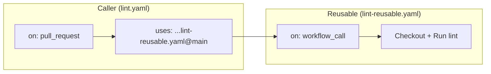
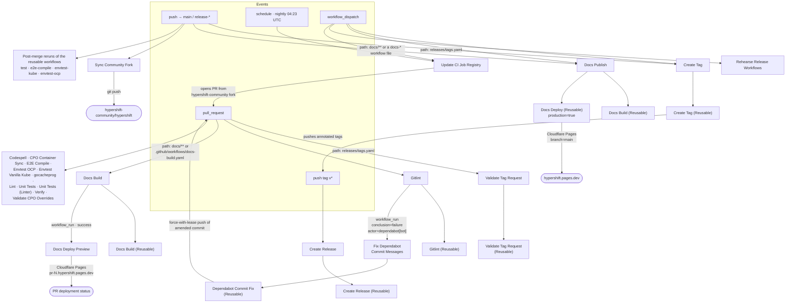
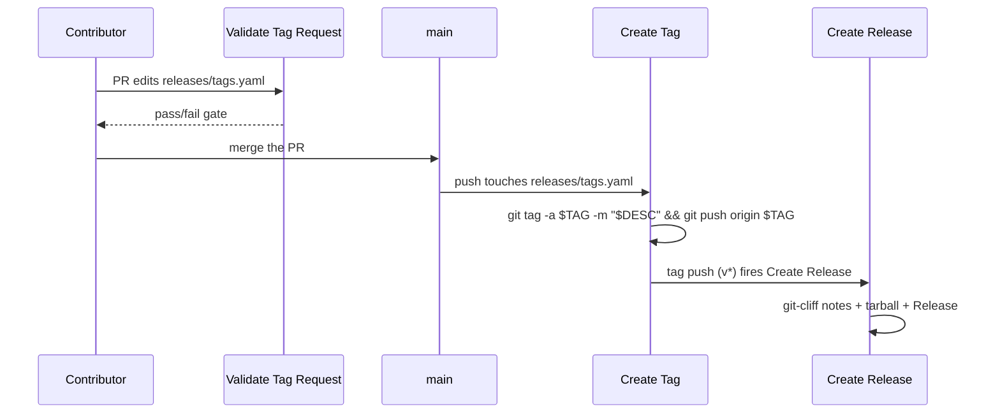

# 🔄 GitHub Actions Workflows

HyperShift uses GitHub Actions for lightweight CI checks that run on every pull request, for post-merge validation, and for release and repository automation. These workflows complement the heavier Prow-based e2e tests by providing fast feedback on code quality, formatting, and documentation.

The repository currently contains **39 workflow files** in `.github/workflows/`: **22 caller or standalone workflows** and **17 reusable workflows** (`*-reusable.yaml`).

## 🏗️ Reusable Workflow Architecture

Most GHA workflows follow a **caller + reusable** pattern:

- **Caller workflow** (e.g., `lint.yaml`) — defines triggers (`pull_request`, branch and path filters) and delegates to a reusable workflow pinned at `@main`.
- **Reusable workflow** (e.g., `lint-reusable.yaml`) — contains the actual job steps. Triggered via `workflow_call` and optionally on `push` for post-merge runs.



This pattern provides:

- ✅ **Consistency** — all PR and push workflows share the same job definitions.
- 🔧 **Maintainability** — job logic is defined once in the reusable workflow and updated in a single place.
- 🔒 **Security** — callers pin reusable workflows to `@main`, reducing the risk of PRs altering reusable job logic. Caller workflows are protected by branch protection rules and CODEOWNERS.

Some workflows intentionally do **not** use the pattern: they are either standalone (`sync-community-fork.yaml`, `update-ci-job-registry.yaml`, `rehearse-release-workflows.yaml`, `validate-cpo-overrides.yaml`) or exist only to react to another workflow's completion (`docs-deploy.yaml`, `dependabot-commit-fix.yaml`).

## 🔗 Trigger Graph

Only a few workflows trigger other workflows. Everything else is triggered directly by an event.



The graph draws `workflow_dispatch` only for manually runnable workflows that feed a chain — **Create Tag**, **Docs Publish**, **Rehearse Release Workflows** and **Update CI Job Registry**. The remaining manually runnable workflows are listed in the **Manual Runs** table further down.

## 📋 Workflow Catalog

The PR validation workflows run on self-hosted ARC runners. Most target `main` and `release-4.22`; only the OCP and vanilla Kubernetes envtest workflows also target `release-5.0`.

Pull request callers resolve their reusable workflows from `main`, while post-merge runs use the reusable workflow stored on the pushed branch. Keep branch-local matrices synchronized with `main`; `release-5.0` envtests must include Kubernetes 1.36 for consistent pull request and post-merge coverage.

### 🧹 Code Quality

| Caller | Reusable | Branches | Path filter | Purpose |
|--------|----------|----------|-------------|---------|
| `codespell.yaml` | `codespell-reusable.yaml` | main, 4.22 | – | Spell checking (`make verify-codespell`) |
| `gitlint.yaml` | `gitlint-reusable.yaml` | main, 4.22 | – | Commit message format validation (`make run-gitlint`) |
| `lint.yaml` | `lint-reusable.yaml` | main, 4.22 | – | Go linting via `golangci-lint` (`make lint`) |
| `verify.yaml` | `verify-reusable.yaml` | main, 4.22 | – | Full verification (`make verify-ci`) |

### 🧪 Testing

| Caller | Reusable | Branches | Path filter | Purpose |
|--------|----------|----------|-------------|---------|
| `test.yaml` | `test-reusable.yaml` | main, 4.22 | – | Sharded unit tests with race detection and Codecov upload; also runs on push to main/4.22 |
| `test-linter.yaml` | `test-linter-reusable.yaml` | main, 4.22 | `hack/tools/**`, `Makefile`, own workflow files | Unit tests for the in-repo `hypershiftlinter` (`make test-linter`) |
| `envtest-ocp.yaml` | `envtest-ocp-reusable.yaml` | main, 4.22, 5.0 | – | CRD validation tests against OpenShift k8s versions; also runs on push |
| `envtest-kube.yaml` | `envtest-kube-reusable.yaml` | main, 4.22, 5.0 | – | CRD validation tests against vanilla k8s versions; also runs on push |
| `e2e-compile.yaml` | `e2e-compile-reusable.yaml` | main, 4.22 | – (skips itself when only `contrib/`, `.github/`, `docs/` changed) | Compiles the e2e v2 test suite so broken tests fail fast; also runs on push |

The envtest suite contents and conventions are described in [`test/envtest/README.md`](https://github.com/openshift/hypershift/blob/main/test/envtest/README.md).

### 📖 Documentation

| Caller | Reusable | Branches | Path filter | Purpose |
|--------|----------|----------|-------------|---------|
| `docs-build.yaml` | `docs-build-reusable.yaml` | main, 4.22 | `docs/**`, `.github/workflows/docs-build.yaml` | Build the Zensical site in strict mode and upload the `docs-site` artifact |
| `docs-publish.yaml` | `docs-build-reusable.yaml` + `docs-deploy-reusable.yaml` | main (push), `workflow_dispatch` | `docs/**`, `.github/workflows/docs-publish.yaml`, `.github/workflows/docs-build-reusable.yaml`, `.github/workflows/docs-deploy-reusable.yaml` | Build and deploy the production site to `hypershift.pages.dev` |

!!! info
    `docs-deploy.yaml` (*Docs Deploy Preview*) is not a caller/reusable pair. It triggers via `workflow_run` after **Docs Build** completes and deploys the preview. The reusable `docs-deploy-reusable.yaml` supports both production and preview modes, but is currently only called with `production: true` from `docs-publish.yaml`. See [Documentation Preview](docs-preview.md) for both flows.

### 🚦 Other PR Gates

| Caller | Reusable | Branches | Path filter | Purpose |
|--------|----------|----------|-------------|---------|
| `validate-cpo-overrides.yaml` | – | main | `hypershift-operator/controlplaneoperator-overrides/assets/overrides.yaml` | Validate CPO override images contain the PRs claimed in the PR description |
| `gocacheprog-test.yaml` | `gocacheprog-test-reusable.yaml` | main, 4.22 | `contrib/ci/gocacheprog/**` | Tests for the `contrib/ci/gocacheprog` build cache tool |
| `cpo-container-sync.yaml` | `cpo-container-sync-reusable.yaml` | main, 4.22 | – | Validate CPO container image references are in sync (`make cpo-container-sync`) |

### 🏷️ Release Pipeline

| Workflow | Reusable | Trigger | Purpose |
|----------|----------|---------|---------|
| `validate-tag-request.yaml` | `validate-tag-request-reusable.yaml` | PR on `releases/tags.yaml` | Gate tag requests (semver, commit reachability, duplicates) |
| `create-tag.yaml` | `create-tag-reusable.yaml` | push to `main` on `releases/tags.yaml`, `workflow_dispatch` | Create and push annotated tags listed in the manifest |
| `create-release.yaml` | `create-release-reusable.yaml` | push tag `v*` | Generate notes with `git-cliff`, build source tarball + SHA256, create the GitHub Release |
| `rehearse-release-workflows.yaml` | – | push to `fix/release-workflow-*` touching `*release*`/`*tag*` workflows, `workflow_dispatch` | Dry-run the release tooling from branch code (read-only) |

The end-to-end flow and its operational use are documented in [HO/CPO Release Process](../../contribute/release-process.md).

### 🤖 Automation and Bots

| Workflow | Trigger | Purpose |
|----------|---------|---------|
| `dependabot-commit-fix.yaml` | `workflow_run` on **Gitlint** failure by `dependabot[bot]` | Rewrite the dependabot commit body into a gitlint-compliant form and force-push the branch |
| `sync-community-fork.yaml` | push to `main`, `release-*` | Fast-forward the matching branch on `hypershift-community/hypershift`. See [Sync Community Fork](sync-community-fork.md) |
| `update-ci-job-registry.yaml` | `schedule` (nightly 04:23 UTC), `workflow_dispatch` | Regenerate `.chai-bot/ci-status-jobs.yaml` from `openshift/release` and open a PR when it changes |
| `docs-deploy.yaml` | `workflow_run` on **Docs Build** success | Deploy the PR docs preview to Cloudflare Pages and post a deployment status |

## 🔁 Trigger Chains

Six chains involve more than one workflow. They are the easiest place to get surprised, so each one is spelled out below.

### 1. Tag request → tag → GitHub Release



`Create Tag` authenticates with a GitHub App token (`JIRA_SOLVE_CI_APP_ID` / `JIRA_SOLVE_CI_PRIVATE_KEY`) because the default `GITHUB_TOKEN` cannot push tags that trigger further workflows. Tags that already exist are skipped, so re-running the workflow is safe.

### 2. Dependabot self-heal loop

1. Dependabot opens a PR whose commit body violates gitlint.
2. **Gitlint** fails.
3. **Fix Dependabot Commit Messages** fires on `workflow_run` (guarded by `conclusion == 'failure'` **and** `actor.login == 'dependabot[bot]'`).
4. It amends the commit (rewriting `Updates <lib> from X to Y` lines into bullets) and force-pushes with `--force-with-lease`.
5. The push re-runs the PR workflows on that branch whose event and path filters match the new commit — path-filtered ones such as **Docs Build** only re-run when their paths change — including Gitlint again.

The loop terminates when Gitlint passes. Humans' PRs never hit this path — the actor guard requires `dependabot[bot]`.

### 3. Docs preview (pull requests)

1. **Docs Build** runs on `pull_request` targeting `main` or `release-4.22` when `docs/**` or `.github/workflows/docs-build.yaml` changes and uploads the `docs-site` artifact.
2. **Docs Deploy Preview** fires on `workflow_run` completion, downloads the artifact, deploys to Cloudflare Pages under `pr-<number>`, and posts a deployment status link on the PR.

PR code is never executed in the deploy workflow, and only the deploy workflow has access to the `docs-preview` environment secrets.

### 4. Docs production (push to main)

**Docs Publish** runs both stages inside a single workflow: a `build` job calls `docs-build-reusable.yaml`, then a `deploy` job (`needs: build`, `production: true`) calls `docs-deploy-reusable.yaml` from the `docs-production` environment. A `docs-production` concurrency group with `cancel-in-progress: true` cancels an older run in the group as soon as a newer one starts, so a burst of merges converges on the newest commit. Cancellation only stops the workflow: a Cloudflare deploy that an older run had already started can still finish, so this is not a strict ordering guarantee.

### 5. Nightly CI job registry

**Update CI Job Registry** regenerates `.chai-bot/ci-status-jobs.yaml` from `openshift/release` and, when the output changes, pushes `automated/update-ci-job-registry-<sha>` to the `hypershift-community` fork and opens a PR. That PR then goes through the normal PR gate set described above.

### 6. Community fork sync

**Sync Community Fork** pushes `main` and every `release-*` branch to `hypershift-community/hypershift` using `COMMUNITY_FORK_TOKEN`. It does not trigger any workflow in this repository — only the fork's own CI, if any.

## ▶️ Manual Runs

These workflows can be started from the Actions tab or with `gh workflow run`:

| Workflow | Command |
|----------|---------|
| Unit Tests | `gh workflow run test.yaml --ref <branch>` |
| E2E Compile | `gh workflow run e2e-compile.yaml --ref <branch>` |
| Envtest OCP / Vanilla Kube | `gh workflow run envtest-ocp.yaml --ref <branch>` |
| Create Tag | `gh workflow run create-tag.yaml --ref main` |
| Docs Publish | `gh workflow run docs-publish.yaml --ref main` |
| Update CI Job Registry | `gh workflow run update-ci-job-registry.yaml` |
| Rehearse Release Workflows | `gh workflow run rehearse-release-workflows.yaml --ref <branch>` |

See also [Triggering Jobs On Demand](triggering-jobs-on-demand.md) for the Prow equivalents.

## 🔑 Secrets and Environments

| Workflow | Secret / environment | Why |
|----------|----------------------|-----|
| `docs-deploy.yaml`, `docs-deploy-reusable.yaml` | `docs-preview` / `docs-production` environments with `CLOUDFLARE_API_TOKEN`, `CLOUDFLARE_ACCOUNT_ID` | Cloudflare Pages deploys |
| `create-tag-reusable.yaml` | `JIRA_SOLVE_CI_APP_ID`, `JIRA_SOLVE_CI_PRIVATE_KEY` | App token that can push tags which trigger `Create Release` |
| `sync-community-fork.yaml`, `update-ci-job-registry.yaml` | `COMMUNITY_FORK_TOKEN` | Authenticate pushes to the community fork |
| `test-reusable.yaml` | `CODECOV_TOKEN` (optional) | Coverage upload |

## ➕ Adding a New Workflow

To add a new GHA workflow:

1. **Create the reusable workflow** (e.g., `my-check-reusable.yaml`) with `on: workflow_call`. This is where all the job logic lives.
2. **Create the caller workflow** (e.g., `my-check.yaml`) that uses the reusable workflow pinned at `@main`.
3. Add **branch filters** for `main` and each release branch where the workflow is intended to run. Do not assume every workflow should target every release branch.
4. Use `arc-runner-set` as the runner.
5. Document it in the catalog above, including its trigger chain if it reacts to or triggers another workflow.

### Post-merge runs

If your workflow should also run after PRs merge to `main` (e.g., for Codecov baseline uploads or post-merge validation), add `on: push` triggers **to the reusable workflow**, not the caller. This lets the reusable workflow run directly on push events without needing a separate caller.

### Why callers pin to `@main`

Callers reference the reusable workflow at `@main` (e.g., `uses: openshift/hypershift/.github/workflows/my-check-reusable.yaml@main`). This means a PR **cannot modify the reusable workflow logic that runs against itself** — it always executes the version from `main`. This is a deliberate security measure: it prevents a PR from weakening checks to make itself pass.

!!! warning "Implication for new workflows"
    When you add a new reusable workflow, the caller in the same PR will **not** be able to reference it until it lands on `main`. You'll need to merge the reusable workflow first (or together with the caller, accepting that the first PR run will use a stale/missing reference).

??? example "Example caller workflow"
    ```yaml
    name: My Check

    on:
      pull_request:
        branches:
          - main
          - release-4.22

    jobs:
      my-check:
        uses: openshift/hypershift/.github/workflows/my-check-reusable.yaml@main
        permissions:
          contents: read
    ```

??? example "Example reusable workflow with post-merge support"
    ```yaml
    name: My Check (Reusable)

    on:
      workflow_call:
      push:
        branches:
          - main
          - release-4.22

    permissions:
      contents: read

    jobs:
      my-check:
        name: My Check
        runs-on: arc-runner-set
        timeout-minutes: 60
        steps:
          - uses: actions/checkout@de0fac2e4500dabe0009e67214ff5f5447ce83dd # v6.0.2
            with:
              persist-credentials: false
          - run: echo "Run your check here"
    ```
