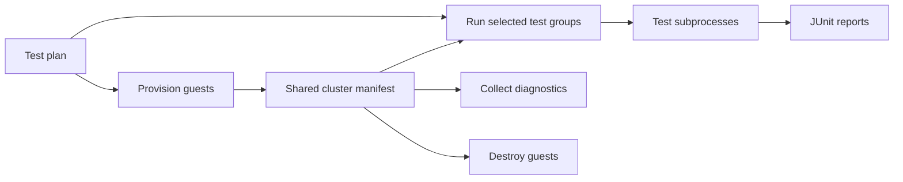

# V2 E2E Test Framework

The v2 framework uses Ginkgo to test hosted clusters, with individual spec results
for CI reporting and Component Readiness.

- [Writing V2 Tests](writing-tests.md): Authoring invariants, test selection,
  local verification, and debugging.
- [Migrating from V1 to V2](migration.md): Procedure for transferring test
  responsibility and retiring the corresponding v1 execution.
- [CI Pipeline Configuration](ci-pipeline.md): Job infrastructure and integration
  with the openshift/release step registry.

## Execution model

The v2 lifecycle separates provisioning, test execution, diagnostic collection,
and teardown. Tests consume operational hosted clusters; lifecycle orchestration
owns provisioning and initial readiness.

This diagram shows responsibilities and data dependencies. CI workflows define
when collection and teardown execute, including after failures; see
[CI Pipeline Configuration](ci-pipeline.md).

A `TestPlan` selects cluster variants and arranges test groups. Platform
implementations own how those variants are provisioned. Each group runs in a
separate test subprocess targeting one hosted cluster, with labels selecting
its coverage. For scheduling and cluster isolation, follow the
[selection rules](writing-tests.md#supply-prerequisites-and-ci-selection).
