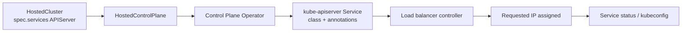

# Deterministic LoadBalancer IP Assignment for the Kube API Server

!!! warning "Technology Preview — Day 1 only"

    Deterministic LoadBalancer IP assignment is a **Technology Preview** feature. It requires
    the management cluster feature gate described in [Prerequisites](#prerequisites) and is
    not supported in production environments.

    This documentation covers **Day 1 only**: selecting the LoadBalancer class and the
    annotations that request a specific address **when the HostedCluster is created**. The
    fields are immutable afterwards. Changing the kube-apiserver LoadBalancer IP on a running
    cluster (Day 2) is **not implemented in OCP 5.1**. See
    [Day 2: Planned behaviour (not implemented)](#day-2-planned-behaviour-not-implemented)
    before you plan any IP change.

## Overview

By default, when the kube-apiserver is published with the `LoadBalancer` strategy, HyperShift
lets the load balancer controller on the management cluster choose the address. That address
can be hard to predict before the cluster exists, which makes firewall rules, DNS records, and
security allowlists difficult to prepare.

This feature adds two provider-agnostic fields to the APIServer entry in
`HostedCluster.spec.services`:

| Field | Purpose |
|-------|---------|
| `loadBalancerClass` | Selects which load balancer controller provisions the kube-apiserver Service. Maps to `Service.spec.loadBalancerClass`. |
| `serviceAnnotations` | Opaque annotation passthrough to the kube-apiserver Service. The annotations request the address and configure provider-specific behaviour. |

HyperShift passes the values to the kube-apiserver Service and the load balancer controller
assigns the requested address. HyperShift does not interpret provider-specific annotation
values.

### What Day 1 provides

| Capability | Status |
|------------|--------|
| Set `loadBalancerClass` for the kube-apiserver Service at creation | Implemented (Technology Preview) |
| Pass `serviceAnnotations` to the kube-apiserver Service at creation | Implemented (Technology Preview) |
| Apply the address annotation to the primary kube-apiserver Service (public or private) | Implemented (Technology Preview) |
| Azure-specific kube-apiserver LoadBalancer Service on port 7443 | Implemented (Technology Preview) |
| Report CPO support through the `DeterministicLBIPSupported` condition | Implemented (Technology Preview) |

### What Day 1 does not provide

- **No runtime IP changes.** You cannot change `loadBalancerClass` or `serviceAnnotations`
  after the HostedCluster is created. Day 2 is a separate, unimplemented scope.
- **No passthrough for other services.** The API accepts the fields on any service entry, but
  the Control Plane Operator only applies them to the `APIServer` service. Values set on
  `OAuthServer`, `Konnectivity`, or `Ignition` are ignored.
- **No typed per-provider API.** Annotation keys and values are not semantically validated
  beyond the allowlist and size limits described in [Validation rules](#validation-rules).
- **No automated DNS management.** On self-managed platforms without ExternalDNS, you must
  update DNS records yourself.
- **No hostname indirection.** Day 1 controls IP addresses only.

### Day 1 compared with Day 2

| Behaviour | Day 1 (OCP 5.1) | Day 2 (planned, not implemented) |
|-----------|----------------------|----------------------------------|
| Set the address at cluster creation | Supported | Supported |
| Change the address on a running cluster | Not supported; the fields are immutable | Planned, without a worker rollout |
| `serviceAnnotations` mutability | Immutable | Planned to be mutable |
| Public bare-metal kubelet path | Through node-local HAProxy when `KubeletHAProxyRouting` is enabled; both gates ship in `TechPreviewNoUpgrade`, but the address is static | Through HAProxy with runtime refresh from `/kas-ip` |
| NodePool version requirement | None | Every NodePool must support Day 2 |

## How it works

1. You create the HostedCluster with `loadBalancerClass` and `serviceAnnotations` on the
   `APIServer` service entry. Both fields require the `DeterministicLBIP` management cluster
   feature gate.
2. The HyperShift Operator mirrors the HostedCluster spec to the HostedControlPlane.
3. The Control Plane Operator reconciles the kube-apiserver Service:
   - It sets `Service.spec.loadBalancerClass` when the field is present.
   - It writes each `serviceAnnotations` entry as a per-key annotation.
4. The load balancer controller that watches the selected class processes the annotations and
   assigns the requested address.
5. The existing `Service.Status.LoadBalancer.Ingress` flow propagates the address to the
   kubeconfig and to the data plane configuration.



## Prerequisites

- A management cluster where you can enable the `DeterministicLBIP` feature gate. Enabling
  `TechPreviewNoUpgrade` at install time also enables this gate:

    ```bash
    hypershift install --tech-preview-no-upgrade
    ```

    The gate controls availability of the API fields, the HyperShift Operator, and the
    Control Plane Operator. Without the gate, the fields are not part of the HostedCluster
    CRD schema: values are dropped by the API server and have no effect. See
    [Feature Gates](../feature-gates.md) for the difference between management cluster and
    hosted cluster feature gates.

- A load balancer controller on the management cluster that can provision the addresses and
  annotations you plan to use. For example, MetalLB with an `IPAddressPool`, the AWS load
  balancer controller with Elastic IPs, or Cilium LB IPAM with a pool.
- The addresses, pools, and any provider resources (Elastic IP allocations, floating network
  IDs, and so on) planned and available **before** cluster creation.
- DNS and firewall rules prepared for the requested address. HyperShift does not create DNS
  records for this feature on self-managed platforms.
- The kube-apiserver published with the `LoadBalancer` strategy. The `loadBalancer` block is
  rejected at admission with other strategy types.
- A HostedCluster release whose Control Plane Operator supports the feature. The
  `loadBalancerClass` is applied only when the kube-apiserver Service is created, so the first
  reconciliation must use a supported Control Plane Operator. See
  [Upgrade, downgrade, and version skew](#upgrade-downgrade-and-version-skew).

## Configure the HostedCluster

The `hypershift` CLI sets these fields at creation time:

- `--kas-service-annotations key=value` is repeatable and populates
  `spec.services[APIServer].servicePublishingStrategy.loadBalancer.serviceAnnotations`.
- `--kas-load-balancer-class <class>` populates
  `spec.services[APIServer].servicePublishingStrategy.loadBalancer.loadBalancerClass`.

Both flags require the `LoadBalancer` APIServer publishing strategy. They cannot be combined
with `--external-dns-domain`, which selects the `Route` strategy. Malformed annotations are
rejected before provisioning, and after creation the CLI verifies that the API server
persisted the fields. If the management cluster HostedCluster CRD lacks the `DeterministicLBIP`
schema, the API server drops the fields and the command fails after the HostedCluster is
created. Delete that HostedCluster, install the HyperShift Operator with
`--tech-preview-no-upgrade`, and create the cluster again.

### Field reference

| Field | Type | Required | Notes |
|-------|------|----------|-------|
| `loadBalancerClass` | string | Optional | Kubernetes qualified name. Maximum 253 characters, name segment maximum 63 characters. Omit it when the management cluster has a single load balancer controller. |
| `serviceAnnotations` | map[string]string | Optional | Minimum 1 and maximum 10 entries. Keys must match the allowlist and be valid qualified names of at most 317 characters. Values are limited to 253 characters. |

Both fields are under:

```yaml
spec:
  services:
  - service: APIServer
    servicePublishingStrategy:
      type: LoadBalancer
      loadBalancer:
        loadBalancerClass: <class>
        serviceAnnotations:
          <key>: <value>
```

### Example: MetalLB with a fixed IP

```yaml
spec:
  services:
  - service: APIServer
    servicePublishingStrategy:
      type: LoadBalancer
      loadBalancer:
        loadBalancerClass: metallb.io/metallb
        serviceAnnotations:
          metallb.io/loadBalancerIPs: "10.1.1.100"
  - service: OAuthServer
    servicePublishingStrategy:
      type: Route
  - service: Konnectivity
    servicePublishingStrategy:
      type: Route
  - service: Ignition
    servicePublishingStrategy:
      type: Route
```

!!! important

    `metallb.io/metallb` is only a valid class if MetalLB is started with a matching
    `--lb-class=metallb.io/metallb` (or the equivalent Helm value). MetalLB versions that are
    not configured with a class only process Services **without** a class. If you use the
    default MetalLB configuration, omit `loadBalancerClass` and keep `serviceAnnotations`.

Create the cluster directly with the flags:

```bash
hypershift create cluster <platform> \
  ... \
  --kas-load-balancer-class=metallb.io/metallb \
  --kas-service-annotations=metallb.io/loadBalancerIPs=10.1.1.100
```

Alternatively, render the HostedCluster manifest, add the fields under `spec.services`, and
apply the manifest:

```bash
hypershift create cluster <platform> \
  ... \
  --render --render-into hostedcluster.yaml

# Edit hostedcluster.yaml and add the loadBalancer fields, then:
oc apply -f hostedcluster.yaml
```

!!! warning "Secrets are not rendered by default"

    `--render` omits Secret objects, including the pull secret and the default encryption key
    referenced by the HostedCluster. Before applying the manifest, make sure the referenced
    pull secret and any other required Secrets already exist in the target namespace, or add
    `--render-sensitive` to include them. A file rendered with `--render-sensitive` contains
    credentials: store it securely and delete it after use.

### Provider examples

The annotation allowlist accepts the following prefixes. The examples are illustrative: your
controller must be configured to watch the selected class, and annotation keys and values must
match what that controller expects.

| Provider | `loadBalancerClass` | Example `serviceAnnotations` |
|----------|--------------------|------------------------------|
| MetalLB | Optional; `metallb.io/metallb` only with a matching `--lb-class` | `metallb.io/loadBalancerIPs: "10.1.1.100"` or `metallb.io/address-pool: "production"` |
| MetalLB (legacy prefix) | Same as above | `metallb.universe.tf/loadBalancerIPs: "10.1.1.100"` |
| AWS NLB | Omit (CCM) or set the class your controller watches | `service.beta.kubernetes.io/aws-load-balancer-eip-allocations: "eipalloc-abc123"` |
| Azure | Omit | `service.beta.kubernetes.io/azure-load-balancer-ipv4: "20.0.0.100"` |
| GCP | Omit, or `networking.gke.io/l4-regional-external` when the backend-service-based controller is required | `networking.gke.io/load-balancer-ip-addresses: "my-ip"` |
| F5 BIG-IP CIS | `f5.com/f5-bigip` | `cis.f5.com/ip: "10.2.2.50"` or `cis.f5.com/ipamLabel: "production"` |
| Cilium | `io.cilium/bgp-control-plane` or `io.cilium/l2-announcer` | `lbipam.cilium.io/ips: "10.3.3.50"` |
| OpenStack | Omit | `loadbalancer.openstack.org/floating-network-id: "<uuid>"` selects the floating IP network, not a specific address |

!!! note "AWS Elastic IPs"

    The EIP example assumes the AWS cloud-controller-manager (CCM) path. If the AWS Load
    Balancer Controller mutates Services, its default scheme is internal, and EIP allocations
    require an internet-facing load balancer. The
    `service.beta.kubernetes.io/aws-load-balancer-scheme` annotation is not in the allowlist,
    so `serviceAnnotations` cannot select the scheme. Use a management cluster configuration
    where the controller creates an internet-facing load balancer, or scope this example to
    CCM. The number of EIP allocations must match the number of selected subnets.

!!! note "GCP load balancer controller"

    On GKE, `networking.gke.io/load-balancer-ip-addresses` is honored by the
    backend-service-based L4 controller. If the management cluster still uses the legacy
    external load balancer path, set
    `loadBalancerClass: networking.gke.io/l4-regional-external`. Otherwise the reserved
    address may not be honored. Check your GKE version and controller configuration.

!!! note "OpenStack does not pin a specific address"

    `loadbalancer.openstack.org/floating-network-id` selects the external network used to
    allocate a floating IP; it does not pin a specific address. The OpenStack cloud provider
    takes a specific floating IP from `Service.spec.loadBalancerIP`, which this feature does
    not expose in Day 1. OpenStack appears here because its annotation prefix is in the
    allowlist, not because it provides deterministic address assignment.

!!! note "Multiple load balancer controllers"

    Setting `loadBalancerClass` is only useful when the management cluster runs more than one
    load balancer controller. The Service stays `Pending` until a controller that watches that
    exact class claims it. Otherwise omit `loadBalancerClass` and let the default controller
    provision the Service, unless your provider requires a class (for example GKE's
    backend-service-based controller).

### Which Service receives the values

The kube-apiserver can be exposed through a public Service, a private Service, or both,
depending on the endpoint access configuration:

| Endpoint access | `loadBalancerClass` | `serviceAnnotations` |
|-----------------|--------------------|---------------------|
| `Public` | Public kube-apiserver Service | Public kube-apiserver Service |
| `Private` | Private kube-apiserver Service | Private kube-apiserver Service |
| `PublicAndPrivate` | Both kube-apiserver LoadBalancer Services | Public kube-apiserver Service only |

The address annotation is applied to the Service that exposes the **primary endpoint** only.
Requesting the same address on both Services can leave one of them `Pending`. The class is
applied to every kube-apiserver Service that is of type `LoadBalancer`, because it selects the
provisioning controller rather than an address.

For Azure, HyperShift uses a dedicated kube-apiserver LoadBalancer Service on port **7443**
instead of 6443. The deterministic fields are applied to that Service.

## Validation rules

The API validates the fields at admission time with CEL. Invalid values are rejected when the
HostedCluster is created.

### `serviceAnnotations`

- Minimum 1 and maximum 10 annotations per service entry.
- Keys must start with one of these prefixes:

    | Prefix | Provider |
    |--------|----------|
    | `metallb.io/` | MetalLB (current) |
    | `metallb.universe.tf/` | MetalLB (legacy) |
    | `service.beta.kubernetes.io/aws-load-balancer-eip` | AWS NLB Elastic IP |
    | `service.beta.kubernetes.io/aws-load-balancer-subnet` | AWS NLB subnet |
    | `service.beta.kubernetes.io/aws-load-balancer-target-group` | AWS NLB target group |
    | `service.beta.kubernetes.io/azure-load-balancer-ipv` | Azure IPv4/IPv6 address |
    | `service.beta.kubernetes.io/azure-load-balancer-resource-group` | Azure resource group |
    | `networking.gke.io/` | GCP, **except** `networking.gke.io/load-balancer-type` |
    | `cis.f5.com/` | F5 BIG-IP CIS |
    | `lbipam.cilium.io/` | Cilium LB IPAM |
    | `loadbalancer.openstack.org/` | OpenStack |

- `networking.gke.io/load-balancer-type` is explicitly rejected because it controls whether
  the load balancer is internal or external.
- Keys must be valid qualified names: an optional DNS subdomain prefix, `/`, and a name
  segment that starts and ends with an alphanumeric character. Keys are limited to 317
  characters and the name segment to 63 characters.
- Values are limited to 253 characters.
- The allowlist validates the provider prefix only. It does not validate that the annotation
  key or value is correct for the provider.

### `loadBalancerClass`

- Optional. When set, it must be a valid Kubernetes qualified name, at most 253 characters,
  with a name segment of at most 63 characters.
- Kubernetes makes `Service.spec.loadBalancerClass` immutable once set. The HostedCluster
  fields follow the same lifetime.

## Verify the configuration

After the cluster is created, check the HostedControlPlane namespace. The namespace is usually
`<hostedcluster-namespace>-<hostedcluster-name>`.

```bash
# Check the class on the kube-apiserver Service.
oc get svc kube-apiserver -n <hcp-namespace> \
  -o jsonpath='{.spec.loadBalancerClass}{"\n"}'

# Check the annotations.
oc get svc kube-apiserver -n <hcp-namespace> \
  -o jsonpath='{.metadata.annotations}{"\n"}'

# Check the assigned address.
oc get svc kube-apiserver -n <hcp-namespace> \
  -o jsonpath='{.status.loadBalancer.ingress[0]}{"\n"}'
```

For clusters with `PublicAndPrivate` endpoint access, the address annotation is expected on the
public Service, not on `kube-apiserver-private`. For `Private` endpoint access, check
`kube-apiserver-private`.

For public Azure clusters (including KubeVirt on Azure), the LoadBalancer Service is named
`kube-apiserverlb`; use that name in the commands above. The `kube-apiserver` Service still
exists as a ClusterIP Service on those clusters and does not carry the LoadBalancer fields.

Confirm that the Control Plane Operator supports the fields:

```bash
oc get hostedcluster <name> -n <namespace> \
  -o jsonpath='{.status.conditions[?(@.type=="DeterministicLBIPSupported")]}{"\n"}'
```

`True` means the Control Plane Operator honors the fields, or that the HostedCluster does not
use them.

## Operate the annotations

- HyperShift writes `serviceAnnotations` entries individually. It does not replace the full
  annotation map.
- Annotations set by other controllers, such as the MetalLB pool status, are preserved across
  reconciliation.
- For keys that pass the allowlist and are also written by HyperShift, HyperShift's value
  wins. On AWS, `service.beta.kubernetes.io/aws-load-balancer-type` is managed by HyperShift
  but is not in the allowlist, so setting it in `serviceAnnotations` is rejected at admission
  rather than silently skipped.
- Removing an annotation from the HostedCluster is not possible in Day 1 because the fields
  are immutable.

## Upgrade, downgrade, and version skew

- **Existing clusters without the fields** behave exactly as before. The fields are optional
  and have no defaults.
- **New HyperShift Operator with an older Control Plane Operator** can happen because the
  Control Plane Operator version follows the HostedCluster release image. The Control Plane
  Operator then ignores the fields. HyperShift reports this through the
  `DeterministicLBIPSupported` condition with status `False` and reason
  `UnsupportedControlPlaneOperator`. Upgrading the HostedCluster control plane release image
  makes the Control Plane Operator apply `serviceAnnotations` on the next reconciliation, but
  it does not retrofit `loadBalancerClass` onto a Service that was already created without
  it. The class is set only when the Service is created, or when an existing Service
  transitions to type `LoadBalancer`. If the older Control Plane Operator already reconciled
  the kube-apiserver Service, create the HostedCluster again with the fields so the class is
  set at creation.
- **Downgrading the HyperShift Operator is not supported for clusters using this feature.**
  The downgraded CRD schema does not contain the fields. Kubernetes can prune them when it
  decodes or writes the stored HostedCluster, so the configuration may be lost, and
  re-upgrading does not guarantee that it is restored. Depending on when pruning happens,
  updates can be rejected or the object can be persisted without the fields, which can leave
  the HostedCluster blocked until the operator is upgraded again. Annotations already written
  to the kube-apiserver Service persist, and the load balancer continues to serve the assigned
  address.
- **Adding the fields to an existing cluster is not supported in Day 1 (Technology Preview).**
  In Day 1, `spec.services` is immutable for all platforms except IBM Cloud, so create a new
  HostedCluster with the fields instead. `loadBalancerClass` remains immutable after creation
  in all phases because Kubernetes makes `Service.spec.loadBalancerClass` immutable. Changing
  `serviceAnnotations` on an existing cluster is planned for Day 2.

## Limitations

- Day 1 only. No runtime address changes.
- Only the `APIServer` service is processed. Other services accept the fields but ignore them.
- `loadBalancer` configuration is only valid with the `LoadBalancer` publishing strategy.
  `Route`, `NodePort`, `None`, and `S3` reject the block at admission.
- HyperShift reads only the first entry of `Service.Status.LoadBalancer.Ingress` to determine
  the control plane endpoint. In dual-stack environments, use an address from the Service's
  primary IP family, which is the family of that first entry. A secondary-family address is
  not consumed by the control plane endpoint.
- No semantic validation of provider annotation keys or values. A misspelled key inside an
  allowed prefix passes admission; the controller ignores it, and the Service may stay
  `Pending` or fall back to a dynamically assigned address.
- A `loadBalancerClass` with no matching controller leaves the Service `Pending` indefinitely.
- No automatic DNS management on self-managed platforms.
- No support for PowerVS or IBM Cloud. The feature targets the load balancer providers in the
  allowlist.

## Troubleshooting

### Admission rejects `serviceAnnotations`

Look for messages such as:

- `serviceAnnotations keys must start with a known load balancer provider prefix`
- `annotation keys must be valid qualified names`
- `annotation keys must be at most 317 characters`
- `annotation values must be at most 253 characters`
- `serviceAnnotations in body should have at least 1 items` or
  `serviceAnnotations in body should have at most 10 items`

Fix the keys or values in the HostedCluster manifest and create the cluster again.

### Admission rejects an update

If you try to change or add the fields after creation, the API returns an error similar to:

```text
Services is immutable. Changes might result in unpredictable and disruptive behavior.
```

This is expected in Day 1. Create a new HostedCluster with the desired values. IBM Cloud is
exempt from the `spec.services` immutability rule.

### The kube-apiserver Service stays `Pending`

Check the following:

1. The Service has the expected class. On public Azure clusters the name is
   `kube-apiserverlb`:

    ```bash
    oc get svc kube-apiserver -n <hcp-namespace> -o yaml
    # Public Azure only:
    oc get svc kube-apiserverlb -n <hcp-namespace> -o yaml
    ```

2. A load balancer controller on the management cluster watches that class. If you set a
   class that no controller handles, the Service never gets an address. Omit the class if you
   are unsure.
3. The requested address or pool exists and has free addresses.
4. The annotation key is spelled exactly as the provider expects. The allowlist checks only
   the prefix.
5. For private clusters, inspect `kube-apiserver-private`. For `PublicAndPrivate` clusters,
   inspect the public Service; the address annotation should not be on the private Service.

### `DeterministicLBIPSupported` is `False`

The Control Plane Operator image in use predates the feature and ignores the fields. Upgrade
the HostedCluster control plane release image so that the Control Plane Operator knows about
the fields. Upgrading applies `serviceAnnotations` on the next reconciliation, but it does not
add `loadBalancerClass` to a Service that was created without it. If the kube-apiserver Service
already exists, create the HostedCluster again with the fields so the class is set at creation.

### The API server is not reachable at the requested address

Verify that the load balancer actually assigned the address, then check the network path:

- Security groups, firewall rules, and routing allow traffic to the address.
- DNS records point to the address, if you use DNS.
- The load balancer controller reports a healthy backend for the kube-apiserver Service.

## Support procedures

- **Detect:** inspect `Service.Status.LoadBalancer.Ingress` and the HostedCluster conditions.
  An empty ingress after the expected provisioning time indicates a load balancer problem.
- **Diagnose:** compare the annotations on the kube-apiserver Service with the provider's
  documentation. Check the load balancer controller logs on the management cluster.
- **Disable:** because the fields are immutable in Day 1, you cannot remove them from an
  existing HostedCluster. To return to dynamic address assignment, create a new HostedCluster
  without the fields.

## Day 2: Planned behaviour (not implemented)

!!! warning "Not implemented — do not rely on this section"

    Everything in this section describes the **intended design for Day 2**. It is **not
    implemented in OCP 5.1** and the details are subject to change. Day 2 is tracked
    separately in [CNTRLPLANE-4796](https://redhat.atlassian.net/browse/CNTRLPLANE-4796) and
    [OCPSTRAT-3926](https://issues.redhat.com/browse/OCPSTRAT-3926). Do not attempt to change
    the kube-apiserver LoadBalancer IP on a running cluster today.

Day 2 targets changing the kube-apiserver LoadBalancer address on a running HostedCluster
without rolling the data plane nodes. The intended design is:

1. `serviceAnnotations` is planned to become mutable after creation. You change the address
   annotation on the HostedCluster.
2. The HyperShift Operator mirrors the change to the HostedControlPlane, and the Control Plane
   Operator applies the new annotations to the kube-apiserver Service.
3. The load balancer controller assigns the new address and updates the Service status.
4. A sidecar in the HAProxy static pod polls a new `/kas-ip` endpoint on the ignition server.
   When the address changes, the sidecar rewrites the HAProxy configuration and sends
   `SIGUSR2` to reload it.
5. Kubelet reaches the API server through the node-local HAProxy instead of the LoadBalancer
   address. This prevents kubelet from being stranded with an old address.

Day 2 also introduces version-skew protection:

- A HostedCluster condition, `ValidLoadBalancerIPConfiguration`, reports whether every
  NodePool supports the runtime address change.
- A NodePool condition, `ValidLoadBalancerIPSupport`, reports whether that NodePool supports
  it.
- NodePools from releases without the sidecar and the `/kas-ip` endpoint are reported as
  unsupported. Changing the address while any NodePool is unsupported is expected to be
  blocked or flagged by the condition.

Prerequisites and implications for Day 2:

- All NodePools must run a release that includes the sidecar and the `/kas-ip` endpoint.
- On public bare-metal clusters, kubelet must route through HAProxy. That routing is
  implemented today behind the `KubeletHAProxyRouting` management cluster feature gate
  (`TechPreviewNoUpgrade`), but the Day 2 address-change mechanism itself is not.
- A brief connectivity window while the new address is propagated is expected.

Until Day 2 is implemented, treat the LoadBalancer address as immutable and plan cluster
recreation if the address must change.

## Related documentation

- [Exposing the Hosted Control Plane Services](exposing-services-from-hcp.md)
- [Service Publishing Strategy Reference](../../reference/service-publishing-strategies.md)
- [Feature Gates](../feature-gates.md)
- [Enhancement: Deterministic LoadBalancer IP Management for Hosted Control Planes](https://github.com/openshift/enhancements/blob/master/enhancements/hypershift/deterministic-loadbalancer-ip-management.md)
