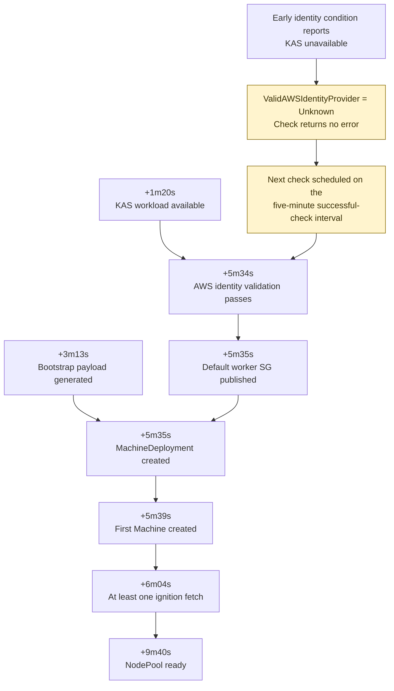
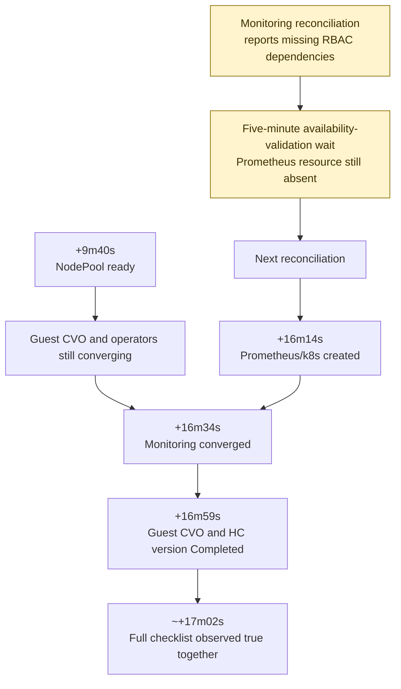

# AWS startup debugging examples (5.0.0-rc.7)

This page records the startup of an AWS HostedCluster created on 28 October
2026, identified as **HostedCluster 1** in the
[comparison of two HostedClusters](cluster-startup-aws-repeat.md). It illustrates
the [startup roadmap](cluster-startup-roadmap.md). The requested HO was healthy
before creation, and startup required no manual credential repair, HO rollout,
or bootstrap changes. The management cluster and its image caches were warm.

!!! note "Development timing example only"

    This HostedCluster was created in development. Its timings illustrate the
    lifecycle gates and do not indicate expected timings for managed services
    such as ROSA HCP or ARO HCP, production deployments, Azure, or other
    environments. They are not performance benchmarks, deadlines, SLAs, or SLOs.

The [creation and deletion observations](cluster-startup-aws-repeat.md)
contain the shared configuration, creation timestamps, startup milestones,
component timings, and guest-operator timings for both HostedClusters. This
page explains the waits observed during HostedCluster 1 startup.

## Observed gates

### Why a ready API did not immediately produce Machines

This diagram measures elapsed time from HostedCluster 1 creation. The timer is
specific to the pinned CPO revision below; it is not a generic AWS timeout.

While this gate is pending, inspect identity-check timing and SG publication.
There is no instance boot path to inspect until Machines and instances exist.

The release CPO revision is `b9d6ae1c63453c012e889525eb924b3a07bac26b`.
Its [AWS identity check](https://github.com/openshift/hypershift/blob/b9d6ae1c63453c012e889525eb924b3a07bac26b/control-plane-operator/controllers/healthcheck/aws.go#L19-L55)
explicitly checks KAS availability before obtaining an EC2 client. Observations
from both HostedClusters contain the condition message
`Cannot validate AWS identity provider while KubeAPIServer is not available`,
with `ValidAWSIdentityProvider=Unknown`. That branch returns no error. When
the complete health-check update, including its status patch, returns no error,
the [health-check controller](https://github.com/openshift/hypershift/blob/b9d6ae1c63453c012e889525eb924b3a07bac26b/control-plane-operator/controllers/healthcheck/healthcheck_controller.go#L19-L52)
selects its five-minute interval. These messages and the pinned source support
the explanation for this HostedCluster; KAS timing alone would not establish it.

The same revision also records `Unknown` and returns no error for an unavailable
EC2 client. Before attributing a similar wait to KAS, verify the deployed CPO
revision, the actual `ValidAWSIdentityProvider` message, and EC2-client and
credential configuration, including `AWS_SHARED_CREDENTIALS_FILE`. These
observations required no credential repair.

`ValidOIDCConfiguration=True` was present from creation. Bootstrap payload
generation at +3m13s preceded worker security-group readiness. CPO AWS
identity-provider validation passed at +5m34s. The default worker security
group and MachineDeployment followed at +5m35s. CAPI created the first Machine at
+5m39s. At least one instance fetched ignition at +6m04s, and the NodePool
became ready at +9m40s.

### Why ready workers did not mean a complete guest cluster

Times use HostedCluster 1 creation as zero. The five-minute validation wait is
part of reconciliation, not a measured duration from NodePool readiness.

Monitoring was the last guest operator to converge. Its initial reconciliation
reported missing `cluster-monitoring-view` and `monitoring-alertmanager-edit`
RBAC dependencies. Prometheus remained absent during a five-minute availability
validation. The next reconciliation created `Prometheus/k8s` at +16m14s;
monitoring converged at +16m34s without manual intervention. Guest CVO and HC
version completion followed at +16m59s, and the full checklist was first
observed at approximately +17m02s.
