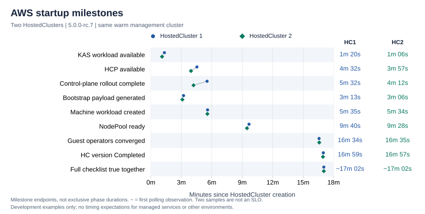
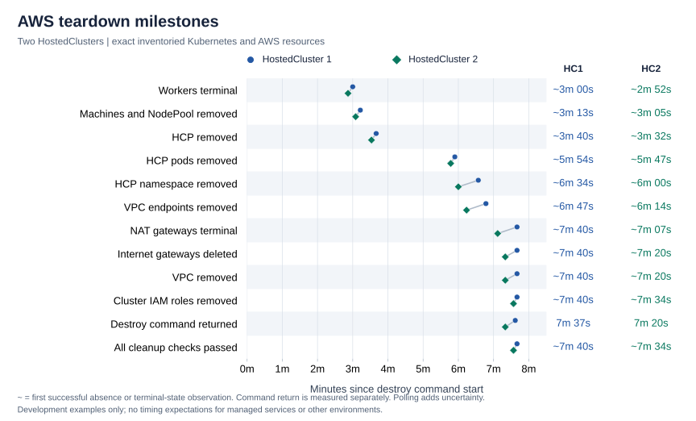
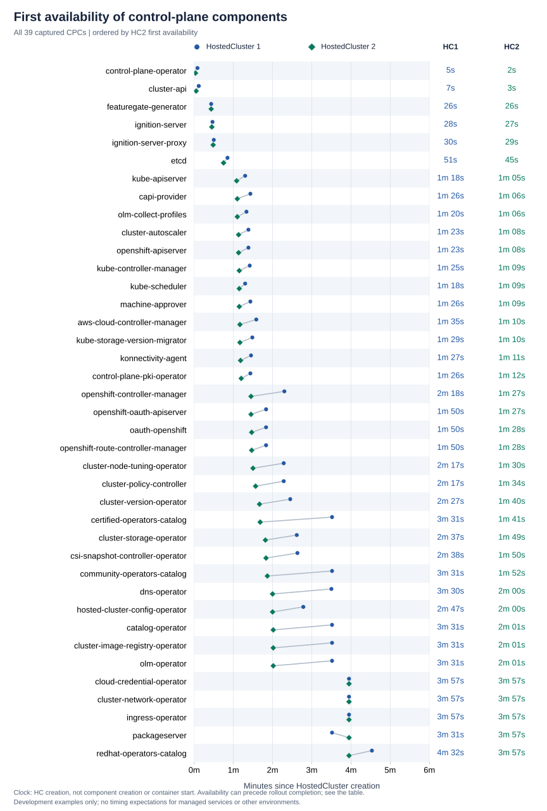
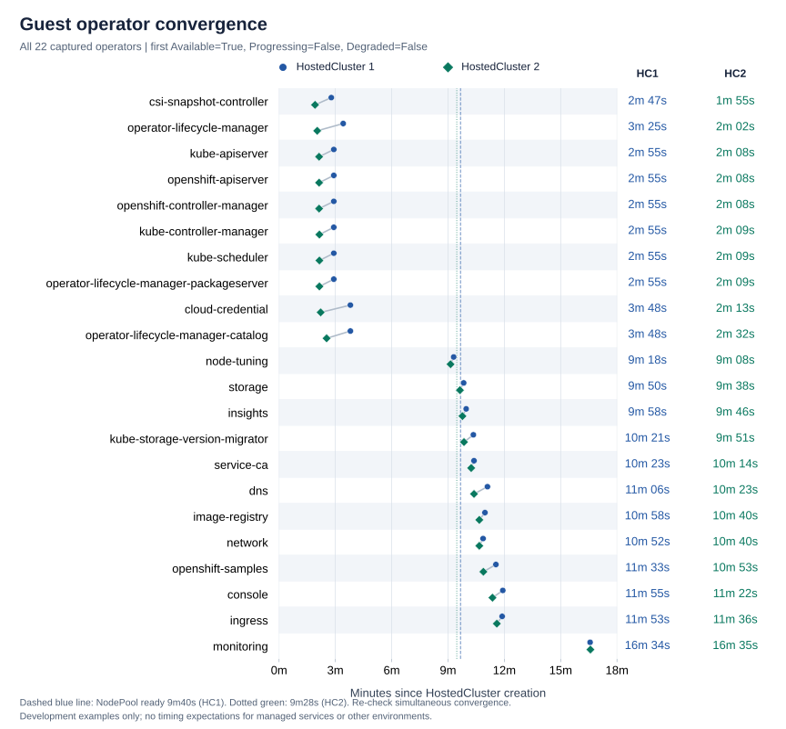

# AWS HostedCluster creation and deletion observations (5.0.0-rc.7)

!!! note "Development timing examples only"

    These HostedClusters were created and destroyed in development. All times
    in the tables and charts are examples from these two runs; they do not
    indicate expected startup or teardown times for managed services such as
    ROSA HCP or ARO HCP, production deployments, Azure, or other environments.
    They are not performance benchmarks, deadlines, SLAs, or SLOs. Measure the
    target environment separately before setting timing expectations.

These observations cover two separate AWS HostedClusters created and then
deleted on the same development management cluster on 28 October 2026. Tables
identify them as **HostedCluster 1** and **HostedCluster 2**; chart labels use
**HC1** and **HC2**. Each has its own creation timestamp, infrastructure ID,
startup measurements, and deletion measurements, listed below.

Both used release
`quay.io/openshift-release-dev/ocp-release:5.0.0-rc.7-multi` and HO image
`quay.io/acm-d/rhtap-hypershift-operator@sha256:d7eb652dbbfac8ae9866b413c7125c86961a5cfb46396eb31774e0b3e171a3a5`.
Each had two `m5.large` workers in `us-east-1a` and public endpoints. Both used
`SingleReplica` policies for the control plane and infrastructure. The management
cluster and its caches were warm. The requested HO was healthy before each create.

Neither startup needed manual credential repair or bootstrap intervention.
Both teardowns used the normal destroy path without force or manual finalizer
removal. Both clusters and their tracked AWS infrastructure were removed.

See the [startup roadmap](cluster-startup-roadmap.md),
[AWS startup debugging examples](cluster-startup-aws-observation.md), and
[teardown roadmap](cluster-teardown-roadmap.md) for gate definitions and
investigation paths.

## Lifecycle summary

Startup times begin at HC creation. Teardown times begin immediately before
invoking the destroy script, including STS refresh and CLI setup.
`~` marks the first successful polling observation. The table lists idle review
time separately and excludes it from both clocks. Startup milestones use the
earliest captured successful transition. Later successful condition timestamps
can differ.

| Measurement | HostedCluster 1 | HostedCluster 2 |
|-------------|---------------|---------------|
| HC creation | `2026-10-28T20:09:30+00:00` | `2026-10-28T21:11:01+00:00` |
| Infrastructure ID | `startup-roadmap-aws-dpqbm` | `startup-roadmap-aws-87pvz` |
| HCP available | 4m 32s | 3m 57s |
| HostedCluster available | 4m 32s | 3m 57s |
| NodePool ready | 9m 40s | 9m 28s |
| Guest operators converged | 16m 34s | 16m 35s |
| HC version Completed | 16m 59s | 16m 57s |
| Full startup checklist | ~17m 02s | ~17m 02s |
| Successful command to HC creation | 18s | 21s |
| Review/idle interval before destroy | ~35m 18s | ~57s |
| Destroy command returned success | 7m 37s | 7m 20s |
| Teardown independently verified | ~7m 40s | ~7m 34s |

These two samples do not establish a typical duration or explain the timing
differences. HostedCluster 1 remained available for review before teardown.
HostedCluster 2's teardown began after capture of its completion evidence and
deletion inventory. HostedCluster 1's command logs retain a NAT-quota retry
before HC creation. That retry does not contribute to startup timing.

## Startup comparison

Each marker measures elapsed time since HC creation. It does not measure the
duration of a separate phase. Both HostedClusters use HC creation as zero, and
`~` marks the first successful polling observation. Select a chart to open the
full-size SVG. The table below contains all values.

| Stage | Milestone | HostedCluster 1 | HostedCluster 2 |
|-------|-----------|---------------|---------------|
| P0 | HostedCluster created | 0s | 0s |
| P0 | Validation passed | 0s | 0s |
| P1 | HostedControlPlane created | 0s | 1s |
| P1 | Platform infrastructure object created | 0s | 1s |
| P1 | CAPI Cluster created | 0s | 1s |
| P1 | Management operators deployed | 4s | 2s |
| P1 | Management operators available | 1m 25s | 1m 06s |
| P2 | HCP InfrastructureReady | 23s | 25s |
| P3 | etcd available | 52s | 45s |
| P3 | featuregate-generator ready | 33s | 30s |
| P4 | Kube API server available | 1m 20s | 1m 06s |
| P4 | HostedCluster kubeconfig published | ~58s | ~48s |
| P5 | HostedControlPlane available | 4m 32s | 3m 57s |
| P5 | HostedCluster available | 4m 32s | 3m 57s |
| P5 | Control-plane rollout complete | 5m 32s | 4m 12s |
| P6 | NodePool created | 0s | 1s |
| P6 | Node bootstrap payload generated | 3m 13s | 3m 06s |
| P6 | MachineDeployment or MachineSet created | 5m 35s | 5m 34s |
| P7 | First CAPI Machine created | 5m 39s | 5m 38s |
| P7 | Ignition endpoint reached | 6m 04s | 6m 02s |
| P8 | All CAPI Machines ready | 9m 39s | 9m 26s |
| P8 | All CAPI Nodes healthy | 9m 39s | 9m 26s |
| P8 | NodePool ready | 9m 40s | 9m 28s |
| P9 | HostedCluster version Completed | 16m 59s | 16m 57s |
| P9 | Guest ClusterVersion complete | 16m 59s | 16m 57s |
| P9 | Guest ClusterOperators converged | 16m 34s | 16m 35s |
| P9 | Full completion checklist | ~17m 02s | ~17m 02s |

### Observed startup waits

Both HostedClusters published valid OIDC configuration immediately and completed
without manual credential repair, an HO rollout, or bootstrap intervention.
HostedCluster 2 first reached HCP availability 35 seconds earlier and NodePool
readiness 12 seconds earlier, while the full checklist was first observed at
about 17m02s in both. These small differences are observations, not evidence of
a reliable performance improvement.

The full trace captures HostedCluster 2's first `Available=True` transition at
+3m57s. A later successful condition carries a +4m12s transition timestamp, also
the control-plane rollout completion time. Both captured observations were
`True`; no intervening `False` was captured. The tables retain the earliest
successful transition rather than replacing it with the latest condition
timestamp.

AWS identity validation passed at +5m34s for HostedCluster 1 and +5m33s for
HostedCluster 2; each default worker security group appeared one second later.
The [startup debugging examples](cluster-startup-aws-observation.md#why-a-ready-api-did-not-immediately-produce-machines)
explain this wait using the observed condition messages and the pinned CPO
source, including how to distinguish KAS unavailability from an unavailable
EC2 client.

Monitoring was the last guest operator to converge in both HostedClusters.
HostedCluster 1 reported missing `cluster-monitoring-view` and
`monitoring-alertmanager-edit` RBAC dependencies. HostedCluster 2 reproduced the
Alertmanager role-binding failure. Its log records the initial failure at
`21:22:06Z`, followed by a five-minute availability-validation wait and a failed
task result at `21:27:06Z`. The next reconciliation created `Prometheus/k8s` at
+16m15s, and monitoring converged at +16m35s. The corresponding HostedCluster 1
times were +16m14s and +16m34s. Reconciliation resolved both failures. Checking
only existing monitoring pods would have missed the absent Prometheus resource
during this interval.

## Teardown comparison

Deletion timestamps and observed absence are different signals. The first
row below uses the HC API deletion timestamp. Resource-removal rows use the
first successful collection that confirms absence or an AWS terminal state.
The command-return row in the summary uses the wrapper's actual return time.

All chart markers except command return are first successful polling
observations. Lines connect the two HostedClusters for comparison; they do not
measure individual cleanup-task durations. The table lists all tracked
resources.

| Gate | HostedCluster 1 | HostedCluster 2 |
|------|---------------|---------------|
| HC deletion timestamp | 2s | 1s |
| Both worker instances terminal | ~3m 00s | ~2m 52s |
| Worker root volumes removed | ~3m 00s | ~3m 05s |
| All CAPI Machines removed | ~3m 13s | ~3m 05s |
| NodePool removed | ~3m 13s | ~3m 05s |
| HCP removed | ~3m 40s | ~3m 32s |
| Guest classic load balancer removed | ~3m 13s | ~3m 05s |
| Control-plane load balancer removed | ~3m 40s | ~3m 32s |
| Tracked target groups removed | ~3m 40s | ~3m 32s |
| OIDC documents removed | ~3m 40s | ~3m 32s |
| All HCP pods removed | ~5m 54s | ~5m 47s |
| Component API objects removed | ~6m 34s | ~6m 00s |
| HCP namespace removed | ~6m 34s | ~6m 00s |
| VPC endpoints removed | ~6m 47s | ~6m 14s |
| Private hosted zones removed | ~6m 47s | ~6m 14s |
| NAT gateways terminal | ~7m 40s | ~7m 07s |
| Internet gateways deleted | ~7m 40s | ~7m 20s |
| Elastic IPs released | ~7m 40s | ~7m 20s |
| VPC removed | ~7m 40s | ~7m 20s |
| Cluster IAM roles removed | ~7m 40s | ~7m 34s |
| Worker instance profiles removed | ~7m 40s | ~7m 34s |
| OIDC provider removed | ~7m 40s | ~7m 20s |
| HC absent | ~7m 40s | ~7m 34s |
| All teardown checks passed | ~7m 40s | ~7m 34s |

### Observed teardown waits

HCP deletion is an intermediate milestone. In both HostedClusters, the workers
terminated and CAPI removed the Machine objects before HCP removal. The HCP
namespace, component API objects, Services and remaining API-server pods
remained afterward. Removing a component API object does not establish that its
workload has stopped.

API-server grace periods explain part of the namespace wait. The HostedCluster 2
observation captured `terminationGracePeriodSeconds` and
`deletionGracePeriodSeconds`: 135 seconds for KAS and 120 seconds for the
OpenShift API and OAuth API servers. For example, the KAS pod was already
observed terminating in the collection ending `21:32:45Z`, with a future
deletion timestamp of `21:34:34Z`. That timestamp is a grace deadline, not a
request time. HostedCluster 1 observations include pod deletion timestamps but
not explicit grace-period fields. HostedCluster 2 observations include both.

Read namespace conditions alongside the remaining objects. In HostedCluster 2,
the namespace reported no remaining content or finalizers while the captured
polls still showed terminating API-server pods and component objects. Check each
resource's presence before concluding that the namespace is empty.

The final CLI phase is separate from controller cleanup. After the HCP
namespace disappeared, the destroy command continued removing remaining VPC
dependencies, NAT infrastructure, IAM roles/profiles and the OIDC provider.
The CLI finalizer kept the HC present during this work. The dataset records
command return and the first collection that confirmed Kubernetes and AWS
cleanup as separate measurements. Neither deletion used force or manual finalizer
removal.

Both commands logged transient internet-gateway `DependencyViolation` errors
for mapped public addresses while the NAT gateway was still `deleting`.
They retried and completed without intervention. In this state, follow NAT
and network-dependency progress before treating a retry message as a leak or
removing a finalizer.

## Control-plane component comparison

First successful transitions may precede later rollouts. These component
transitions are separate from aggregate HCP availability and full completion.

The chart compares first availability in both HostedClusters. The table lists
components alphabetically and retains both availability and rollout timestamps.
These observations do not establish a dependency order. Rollout completion can
follow availability. Open the image for the full-size vector chart.

| Component | First available: HostedCluster 1 | First available: HostedCluster 2 | First rollout: HostedCluster 1 | First rollout: HostedCluster 2 |
|-----------|--------------------------|--------------------------|------------------------|------------------------|
| `aws-cloud-controller-manager` | 1m 35s | 1m 10s | 1m 35s | 1m 10s |
| `capi-provider` | 1m 26s | 1m 06s | 1m 31s | 1m 06s |
| `catalog-operator` | 3m 31s | 2m 01s | 3m 31s | 2m 01s |
| `certified-operators-catalog` | 3m 31s | 1m 41s | 3m 31s | 1m 41s |
| `cloud-credential-operator` | 3m 57s | 3m 57s | 3m 57s | 3m 57s |
| `cluster-api` | 7s | 3s | 7s | 3s |
| `cluster-autoscaler` | 1m 23s | 1m 08s | 1m 23s | 1m 08s |
| `cluster-image-registry-operator` | 3m 31s | 2m 01s | 3m 31s | 2m 01s |
| `cluster-network-operator` | 3m 57s | 3m 57s | 5m 30s | 3m 57s |
| `cluster-node-tuning-operator` | 2m 17s | 1m 30s | 2m 17s | 1m 30s |
| `cluster-policy-controller` | 2m 17s | 1m 34s | 2m 17s | 1m 34s |
| `cluster-storage-operator` | 2m 37s | 1m 49s | 3m 57s | 3m 57s |
| `cluster-version-operator` | 2m 27s | 1m 40s | 2m 27s | 1m 40s |
| `community-operators-catalog` | 3m 31s | 1m 52s | 3m 31s | 1m 52s |
| `control-plane-operator` | 5s | 2s | 5s | 2s |
| `control-plane-pki-operator` | 1m 26s | 1m 12s | 1m 26s | 1m 12s |
| `csi-snapshot-controller-operator` | 2m 38s | 1m 50s | 2m 48s | 2m 01s |
| `dns-operator` | 3m 30s | 2m 00s | 3m 30s | 2m 00s |
| `etcd` | 51s | 45s | 51s | 45s |
| `featuregate-generator` | 26s | 26s | 33s | 30s |
| `hosted-cluster-config-operator` | 2m 47s | 2m 00s | 2m 47s | 2m 00s |
| `ignition-server` | 28s | 27s | 28s | 27s |
| `ignition-server-proxy` | 30s | 29s | 30s | 29s |
| `ingress-operator` | 3m 57s | 3m 57s | 3m 57s | 3m 57s |
| `konnectivity-agent` | 1m 27s | 1m 11s | 1m 27s | 1m 11s |
| `kube-apiserver` | 1m 18s | 1m 05s | 1m 18s | 1m 05s |
| `kube-controller-manager` | 1m 25s | 1m 09s | 1m 29s | 1m 15s |
| `kube-scheduler` | 1m 18s | 1m 09s | 1m 23s | 1m 17s |
| `kube-storage-version-migrator` | 1m 29s | 1m 10s | 1m 29s | 1m 10s |
| `machine-approver` | 1m 26s | 1m 09s | 1m 26s | 1m 09s |
| `oauth-openshift` | 1m 50s | 1m 28s | 2m 20s | 1m 34s |
| `olm-collect-profiles` | 1m 20s | 1m 06s | 1m 20s | 1m 06s |
| `olm-operator` | 3m 31s | 2m 01s | 3m 31s | 2m 01s |
| `openshift-apiserver` | 1m 23s | 1m 08s | 1m 44s | 1m 21s |
| `openshift-controller-manager` | 2m 18s | 1m 27s | 2m 18s | 1m 27s |
| `openshift-oauth-apiserver` | 1m 50s | 1m 27s | 2m 20s | 1m 30s |
| `openshift-route-controller-manager` | 1m 50s | 1m 28s | 2m 19s | 1m 30s |
| `packageserver` | 3m 31s | 3m 57s | 3m 31s | 3m 57s |
| `redhat-operators-catalog` | 4m 32s | 3m 57s | 4m 32s | 3m 57s |

### Creation to component availability

These durations start at `ControlPlaneComponent` object creation and include
controller and dependency waits. They do not measure container startup time.

| Component | HostedCluster 1 | HostedCluster 2 |
|-----------|---------------|---------------|
| `aws-cloud-controller-manager` | 1m 11s | 46s |
| `capi-provider` | 1m 22s | 1m 04s |
| `catalog-operator` | 3m 06s | 1m 36s |
| `certified-operators-catalog` | 3m 06s | 1m 16s |
| `cloud-credential-operator` | 3m 33s | 3m 33s |
| `cluster-api` | 3s | 1s |
| `cluster-autoscaler` | 30s | 22s |
| `cluster-image-registry-operator` | 3m 07s | 1m 37s |
| `cluster-network-operator` | 3m 33s | 3m 33s |
| `cluster-node-tuning-operator` | 1m 53s | 1m 06s |
| `cluster-policy-controller` | 1m 53s | 1m 10s |
| `cluster-storage-operator` | 2m 13s | 1m 25s |
| `cluster-version-operator` | 2m 03s | 1m 16s |
| `community-operators-catalog` | 3m 06s | 1m 27s |
| `control-plane-operator` | 4s | 1s |
| `control-plane-pki-operator` | 1m 03s | 49s |
| `csi-snapshot-controller-operator` | 2m 14s | 1m 26s |
| `dns-operator` | 3m 06s | 1m 36s |
| `etcd` | 27s | 22s |
| `featuregate-generator` | 2s | 3s |
| `hosted-cluster-config-operator` | 2m 23s | 1m 36s |
| `ignition-server` | 3s | 2s |
| `ignition-server-proxy` | 5s | 4s |
| `ingress-operator` | 3m 33s | 3m 33s |
| `konnectivity-agent` | 1m 03s | 47s |
| `kube-apiserver` | 54s | 42s |
| `kube-controller-manager` | 1m 01s | 46s |
| `kube-scheduler` | 54s | 46s |
| `kube-storage-version-migrator` | 1m 04s | 45s |
| `machine-approver` | 33s | 23s |
| `oauth-openshift` | 1m 26s | 1m 04s |
| `olm-collect-profiles` | 55s | 41s |
| `olm-operator` | 3m 06s | 1m 36s |
| `openshift-apiserver` | 59s | 44s |
| `openshift-controller-manager` | 1m 54s | 1m 03s |
| `openshift-oauth-apiserver` | 1m 26s | 1m 03s |
| `openshift-route-controller-manager` | 1m 26s | 1m 04s |
| `packageserver` | 3m 06s | 3m 32s |
| `redhat-operators-catalog` | 4m 07s | 3m 32s |

## Guest operator comparison

An operator converges when it reports `Available=True`, `Progressing=False`, and
`Degraded=False`. It can resume progressing afterward. Full completion requires
all operators to report these conditions in the same collection cycle.

The vertical reference lines mark NodePool readiness. Some operators converge
before workers; others need guest workloads to run. Monitoring is the last
operator in these two observations. Check all operators together before
reporting full completion.

| Operator | HostedCluster 1 | HostedCluster 2 |
|----------|---------------|---------------|
| `cloud-credential` | 3m 48s | 2m 13s |
| `console` | 11m 55s | 11m 22s |
| `csi-snapshot-controller` | 2m 47s | 1m 55s |
| `dns` | 11m 06s | 10m 23s |
| `image-registry` | 10m 58s | 10m 40s |
| `ingress` | 11m 53s | 11m 36s |
| `insights` | 9m 58s | 9m 46s |
| `kube-apiserver` | 2m 55s | 2m 08s |
| `kube-controller-manager` | 2m 55s | 2m 09s |
| `kube-scheduler` | 2m 55s | 2m 09s |
| `kube-storage-version-migrator` | 10m 21s | 9m 51s |
| `monitoring` | 16m 34s | 16m 35s |
| `network` | 10m 52s | 10m 40s |
| `node-tuning` | 9m 18s | 9m 08s |
| `openshift-apiserver` | 2m 55s | 2m 08s |
| `openshift-controller-manager` | 2m 55s | 2m 08s |
| `openshift-samples` | 11m 33s | 10m 53s |
| `operator-lifecycle-manager` | 3m 25s | 2m 02s |
| `operator-lifecycle-manager-catalog` | 3m 48s | 2m 32s |
| `operator-lifecycle-manager-packageserver` | 2m 55s | 2m 09s |
| `service-ca` | 10m 23s | 10m 14s |
| `storage` | 9m 50s | 9m 38s |

## Measurement limits

Startup and teardown were polled at ten-second intervals, with query duration
adding to the interval between observations. Startup polling timestamps mark
query start; teardown absence timestamps mark query completion. API transition
timestamps are used where available. Polling observations are approximate:
queries span a time window, and AWS eventual consistency can delay a result.
A failed query leaves the resource state unknown; it does not prove deletion.

Teardown checks covered the worker VPC and its resources, plus control-plane
load balancers discovered through HCP Services in the management VPC. Shared
management resources, the HO installation, OIDC bucket, and base-domain zone
were outside the teardown scope.
