# Hosted cluster startup roadmap

This page follows HostedCluster startup, beginning with creation of the
`HostedCluster` API object and ending when the control plane, requested workers,
and guest operators are ready. It covers AWS and self-managed Azure with
managed etcd (`spec.etcd.managementType=Managed`). Unmanaged-etcd clusters use
an external etcd service and do not deploy or wait for the managed-etcd
component shown in this roadmap. Their external-etcd configuration and
availability need separate checks. ARO HCP uses a different provisioning
process and is outside this guide's scope.

This guide uses HC for HostedCluster, HCP for HostedControlPlane, CPC for
ControlPlaneComponent, and KAS for kube-apiserver.

For component timings and debugging examples, see the
[AWS startup debugging examples for 5.0.0-rc.7](cluster-startup-aws-observation.md)
and the [comparison of two HostedClusters](cluster-startup-aws-repeat.md).
For deletion stages, cleanup checks, and teardown timing examples, see the
[AWS teardown roadmap](cluster-teardown-roadmap.md).

!!! note "Timing examples from development clusters only"

    All measured times in these lifecycle pages and charts come from two AWS
    HostedClusters created and destroyed in development on the same warm
    management cluster. They illustrate readiness and cleanup gates; they do
    not indicate expected startup or teardown times for managed services such
    as ROSA HCP or ARO HCP, production deployments, Azure, or other environments.
    They are not performance benchmarks, deadlines, SLAs, or SLOs. Measure the
    target environment separately before setting timing expectations.

The roadmap follows the controllers in this repository. These controllers
can work at the same time:

- The HyperShift Operator (HO) continues creating management-cluster
  resources while the Control Plane Operator (CPO) starts the control plane.
- CAPI infrastructure can continue provisioning while control-plane workloads
  are starting.
- NodePool bootstrap can begin as soon as the hosted API kubeconfig exists,
  before every control-plane component has finished rolling out.
- Guest ClusterVersion and ClusterOperator convergence continues after the
  NodePool reports ready.

Use the stage gates below to find the next unmet dependency. Check the
dependency conditions as well as the timestamps to establish startup order.

!!! note "Existing SLO targets are not observed baselines"

    [SLOs](SLOs.md) defines CI targets such as HostedCluster availability in
    under five minutes, NodePool availability in under eight minutes, and full
    rollout in under fifteen minutes. Those are targets under a documented CI
    environment, not general AWS or Azure medians. Collect a baseline with the
    timeline tooling described in [Measuring startup](#measuring-startup)
    before making timing claims.

## What "ready" means

Each readiness signal answers a different question:

| Question | Authoritative signal | What it does not prove |
|----------|----------------------|------------------------|
| Are the published control-plane endpoints available? | HCP `InfrastructureReady=True` | The `AWSCluster` or `AzureCluster`, worker networks, or guest nodes are ready. |
| Is the hosted API server workload available? | HCP `KubeAPIServerAvailable=True` plus the endpoint checks described in P4 | Every control-plane component is available. |
| Can the hosted API be used by the HO and NodePool controller? | `HostedCluster.status.kubeconfig` is populated | Workers have joined or the guest cluster has converged. |
| Is the hosted control plane available? | HCP `Available=True`, copied to HostedCluster `Available=True` | Any NodePool exists or is ready. |
| Has the management-side control plane completed its rollout? | HCP `status.controlPlaneVersion.history[0].state=Completed`, with every `ControlPlaneComponent` at the desired version and `RolloutComplete=True` | The guest ClusterVersion or ClusterOperators have converged. |
| Are the requested workers ready? | NodePool `Ready=True`, `AllMachinesReady=True`, and `AllNodesHealthy=True` | Every guest operator is stable or complete. |
| Is the guest release rollout complete? | HostedCluster `status.version.history[0].state=Completed` and desired image match | Every ClusterOperator is necessarily converged at that instant. |
| Is the cluster operationally complete? | The full checklist in [Full completion](#p9-guest-convergence-and-full-completion) | Conditions will remain healthy after this check. |

!!! warning

    HostedCluster `Available=True` can be true while a NodePool is still
    provisioning. NodePool `Ready=True` can be true while the guest CVO is still
    progressing. HostedCluster `Progressing=False` alone is also not a
    completion check. The HO's `Progressing` condition mainly tracks whether the
    desired release image differs from the observed release.

## Startup dependency graph

Click any diagram on this page to open the full-screen viewer. Click again to
zoom, then drag to follow the diagram; on touch screens, pinch to zoom.



The diagram shows hard gates, not exact execution order. For example, the CPO
can publish endpoints while CAPI is still creating cloud infrastructure, and the
NodePool controller can build bootstrap resources while OLM or another
control-plane component is still becoming available. Kubeconfig publication
and KAS Deployment availability are separate observations; the kubeconfig can
be published first. HCP availability and control-plane rollout completion are
also separate gates, both required by the full completion checklist.

### Check control-plane, worker, and guest readiness

Check all three groups of conditions. Control-plane availability alone does
not establish worker or guest readiness. The arrows join the required checks;
they do not show startup order.



If the user requested only a control plane, report its readiness. Do not create
workers when the user intentionally omitted NodePools or set zero replicas.

## Stage map

| Stage | Hard gate to leave the stage | Primary evidence | First place to investigate |
|-------|------------------------------|------------------|----------------------------|
| P0 Intake | HO accepts the HostedCluster configuration and release image | HostedCluster validation conditions; HCP may not exist yet | HostedCluster conditions and HO logs |
| P1 Management resources | HCP, platform infrastructure CR, and CAPI `Cluster` exist; management operators are deployed | HCP and CAPI resources; HO deployments | HO logs, namespace events, credential Secrets |
| P2 Endpoints | HCP `InfrastructureReady=True` | HCP condition; Services, Routes, load balancers, DNS | HCP condition reason; endpoint resources; platform DNS/endpoint conditions |
| P3 Foundation | Managed etcd and featuregate-generator are ready | CPC status; etcd StatefulSet; featuregate Job; HCP `EtcdAvailable` | etcd pods, PVCs, events, certificates; featuregate Job |
| P4 KAS | KAS workload is available and the hosted kubeconfig is published | HCP `KubeAPIServerAvailable`; HCP kubeconfig; HostedCluster kubeconfig | KAS deployment, pods, Service/LB health, HCP status reason |
| P5 Control-plane convergence | Every CPC is available and rollout-complete at the desired version | CPC conditions; HCP `Available` and `controlPlaneVersion` | CPC dependency messages, deployment status, component operand status |
| P6 NodePool bootstrap | Bootstrap payload, token, machine template, and CAPI workload exist | NodePool conditions and Secrets; MachineDeployment or MachineSet | NodePool conditions, kubeconfig status, user-data/token Secrets, HO logs |
| P7 Machine provisioning | Cloud machine exists and at least one instance reaches ignition | CAPI Machine and platform machine; NodePool `ReachedIgnitionEndpoint` | CAPI provider logs, machine events, ignition DNS/endpoint, console logs |
| P8 Worker readiness | Machines are ready and nodes are healthy | NodePool `Ready`, `AllMachinesReady`, `AllNodesHealthy` | CAPI Machine conditions, NodePool aggregate messages, guest node and network status |
| P9 Guest convergence | Guest CVO completes and ClusterOperators converge | HostedCluster `status.version`; guest CVO and ClusterOperators | Guest CVO, ClusterOperators, HCCO logs, HCP conditions |

## Before P0: provisioning inputs

The roadmap clock starts when the HostedCluster API object is created. The
create command can provision infrastructure before that point.
For example, `hypershift create cluster aws` creates the VPC, subnets, NAT
gateway, DNS zones, OIDC configuration, and IAM roles before submitting the
HostedCluster, unless existing infrastructure and IAM inputs are supplied.

Before the HostedCluster object exists, inspect the create command's logs
for progress and errors. An AWS NAT gateway or IAM provisioning wait at this
point is outside P0; it cannot appear in HostedCluster conditions because the
object does not exist yet. The later `AWSCluster` resource represents the CAPI
infrastructure object, not the start of this CLI provisioning work.

An AWS `NatGatewayLimitExceeded` error is another example of a failure before
P0. Check the NAT gateway quota and usage in the selected availability zone,
including gateways being deleted. A failed create can leave a VPC, subnets,
internet gateway, and allocated Elastic IP even though no HostedCluster exists.
Preserve the failed attempt's infrastructure ID and logs, then clean up those
resources before retrying; do not treat "no HostedCluster found" as proof that
the create command allocated nothing.

Record both intervals to include the work before HC creation:

- Command start to HostedCluster creation: infrastructure and identity setup.
- HostedCluster creation to each readiness gate: the P0 through P9 controller timeline.

Record create-command start before running the create script. Use the
HostedCluster creation timestamp as t=0 so infrastructure setup before object
creation stays separate from P0–P9 controller startup.

## P0: intake and validation

The HO validates the HostedCluster before it can create a usable control plane.
The exact validation set depends on platform and capabilities, but common
conditions include:

- `ValidConfiguration`
- `SupportedHostedCluster`
- `ValidReleaseImage`
- `ValidIDPConfiguration`
- `ValidProxyConfiguration`
- AWS: `ValidAWSIdentityProvider`, `ValidAWSKMSConfig`, and related credential
  and endpoint conditions
- Azure: `ValidAzureKMSConfig` and workload-identity validation

If a blocking validation condition is false, the HO stops the remaining startup
work for that reconciliation. This appears as a HostedCluster condition or a blocked
`Progressing` reason, often before an HCP exists.

Validation continues after the HO creates the initial resources. For example,
OIDC document publication can fail after KAS has started. Depending on the
deployed CPO revision, an AWS identity check can remain `Unknown` while KAS or
its EC2 client is unavailable; inspect the actual condition message. A later
`ValidOIDCConfiguration=False` can therefore make P0 the first false gate while
P1 through P4 resources already exist. Read the condition message and HO logs
to identify the failure. A failed validation condition does not mean those
resources were removed.

For an AWS OIDC upload failure, distinguish the two credential file formats:
`create cluster aws --sts-creds` accepts STS JSON, while
`install --oidc-storage-provider-s3-credentials` supplies a shared AWS INI
profile to the HO SDK. Temporary credentials in that profile need
`aws_session_token` as well as the access key and secret key. An HO log showing
credential fallback to EC2 IMDS can indicate an unreadable or incorrectly
formatted profile; it does not necessarily mean the STS session expired.

Inspect:

```bash
oc get hostedcluster "$HC_NAME" -n "$HC_NAMESPACE" \
  -o json | jq -r '.status.conditions[]
  | [.type, .status, .reason, .message, .lastTransitionTime] | @tsv'

oc logs -n hypershift deployment/operator --tail=200
```

## P1: management-cluster resources

After validation, the HO reconciles these resources:

1. Resolve the CPO image and create or update the control-plane namespace. The
   namespace name is `<hostedcluster-namespace>-<hostedcluster-name>`, with dots
   in the cluster name replaced by dashes.
2. Reconcile platform credentials, pull secret, and encryption configuration.
3. Reconcile the `HostedControlPlane`, then the platform infrastructure CR,
   then the CAPI `Cluster`.
4. Deploy the CPO, CAPI manager (`cluster-api`), CAPI provider
   (`capi-provider`), and optionally Karpenter.
5. Reconcile RBAC and network policies.

!!! note "HostedCluster namespaces can be shared"

    Multiple HostedCluster definitions can share the management-cluster
    namespace that contains the HostedCluster resources. Each HostedCluster
    still gets its own derived HostedControlPlane namespace,
    `<hostedcluster-namespace>-<hostedcluster-name>`. NodePools select their
    HostedCluster with `spec.clusterName`; filter by that field when tracking
    worker readiness so unrelated HostedClusters are not mixed together.

    For per-cluster disaster recovery, OCPBUGS-61116 reports that restoring a
    backup which includes a shared HostedCluster namespace can also restore
    other HostedClusters' resources from that namespace. Use separate
    HostedCluster namespaces or cluster-specific backup filtering in that case.

The platform infrastructure CR is `AWSCluster` on AWS and `AzureCluster` on
self-managed Azure. Azure also creates an `AzureClusterIdentity`.

This stage is shared by AWS and Azure, but the credential and identity inputs
differ:

| Concern | AWS | Self-managed Azure |
|---------|-----|--------------------|
| Management identity | STS/OIDC federation and IAM roles; CAPA credential Secrets | Workload identities and federated credentials; `AzureClusterIdentity` |
| CAPI infrastructure | `AWSCluster` | `AzureCluster` plus `AzureClusterIdentity` |
| CAPI provider | CAPA (`capi-provider`) | CAPZ (`capi-provider`) |

Inspect:

```bash
oc get hostedcontrolplane "$HC_NAME" -n "$HCP_NAMESPACE" -o yaml
oc get cluster.cluster.x-k8s.io -n "$HCP_NAMESPACE"
oc get awscluster -n "$HCP_NAMESPACE"                 # AWS
oc get azurecluster,azureclusteridentity -n "$HCP_NAMESPACE"  # Azure
oc get deployment -n "$HCP_NAMESPACE" \
  control-plane-operator cluster-api capi-provider
oc get events -n "$HCP_NAMESPACE" --sort-by=.lastTimestamp
```

An existing HCP only proves that the API object was created. It does not prove
that the CPO is running or that the platform infrastructure is ready.

On AWS, the `capi-provider` pod can initially wait for the
`service-network-admin-kubeconfig` Secret. Its init container uses the guest API,
so the pod can remain unready while P2 through P4 proceed. A transient
`FailedMount` event for that Secret alone does not establish that AWS credentials
are wrong. Check whether KAS is still starting before treating this as a
separate provider failure.

## P2: endpoint publication

The CPO first reconciles the infrastructure services used to publish the control
plane: API server, Konnectivity, OAuth when enabled, OpenShift API server, OLM
package server, and HCP router services. It then reads their status.

`InfrastructureReady=True` means the required published endpoint addresses are
available. It does not mean the `AWSCluster` or `AzureCluster` is ready. Cloud
network creation and CAPI reconciliation can still be in progress.

If the condition is false, read its reason and message first. Common reasons
point to:

- A missing or unpopulated load balancer
- A Service or Route that has not received an address
- A DNS hostname that does not resolve
- An API server or Konnectivity service with no published host/port
- A required internal or external router that is not ready

Platform-specific checks:

- AWS: KAS load balancer or Route, HCP router, endpoint services/PrivateLink,
  and managed or external DNS. Look for `AWSEndpointServiceAvailable`,
  `AWSEndpointAvailable`, `ExternalDNSReachable`, and `PublicEndpointExposed`
  conditions where applicable.
- Azure: KAS load balancer, DNS, and, for private clusters, the
  `AzurePrivateLinkService` status and private DNS resources. Azure KAS load
  balancing in the code examined uses service port `7443` because `6443`
  collides with the management cluster's public load-balancer rule.

Inspect:

```bash
oc get hostedcontrolplane "$HC_NAME" -n "$HCP_NAMESPACE" \
  -o jsonpath='{range .status.conditions[?(@.type=="InfrastructureReady")]}{.status}{"\t"}{.reason}{"\t"}{.message}{"\n"}{end}'
oc get service,route -n "$HCP_NAMESPACE"
oc get events -n "$HCP_NAMESPACE" --sort-by=.lastTimestamp
oc logs -n "$HCP_NAMESPACE" deployment/control-plane-operator --tail=200
```

## P3: foundation components

The CPO does not reconcile its component set until the published infrastructure
is ready. When it starts, the first dependency chain is:



`kube-apiserver` has explicit dependencies on managed etcd and
`featuregate-generator`. Most other components wait for KAS to be available and
rollout-complete through an implicit dependency. The exceptions are:

- etcd components, including configured shards such as `etcd-events`
- featuregate-generator
- control-plane-operator
- cluster-api
- capi-provider
- karpenter and karpenter-operator
- router
- ignition-server
- ignition-server-proxy

Router still depends on ignition-server, and the ignition proxy also depends on
ignition-server.

!!! note

    Component registration order is not startup order. For example,
    `control-plane-pki-operator` is registered early but has the implicit KAS
    dependency, so it is not the first component to reconcile during initial
    startup.

The CPO reports managed etcd status through HCP `EtcdAvailable` and KAS status
through HCP `KubeAPIServerAvailable`. It computes both conditions from the
existing StatefulSet and Deployment before reconciling component updates. A
condition can therefore lag the workload by a reconcile cycle.

Inspect:

```bash
oc get controlplanecomponent -n "$HCP_NAMESPACE"
oc get controlplanecomponent etcd featuregate-generator kube-apiserver \
  -n "$HCP_NAMESPACE" -o yaml
oc get statefulset etcd -n "$HCP_NAMESPACE"
oc get pods -n "$HCP_NAMESPACE" -l app=etcd
oc get jobs,pods -n "$HCP_NAMESPACE" | grep featuregate
oc get events -n "$HCP_NAMESPACE" --sort-by=.lastTimestamp
```

For etcd, inspect PVC binding and storage events. For featuregate-generator,
inspect the Job and its pod logs.

## P4: kube API server and kubeconfig

Several controllers depend on KAS:

- Remaining control-plane components wait for KAS.
- The HO needs an HCP kubeconfig to publish `HostedCluster.status.kubeconfig`.
- The NodePool controller waits for `HostedCluster.status.kubeconfig` before it
  generates node bootstrap data.

`KubeAPIServerAvailable=True` comes from the KAS Deployment's `Available`
condition. HCP availability separately runs the KAS endpoint health check.
For public `Route` or `LoadBalancer` publishing, CPO probes the corresponding
endpoint. For a private HCP, CPO probes the internal `kube-apiserver` Service.
A running pod can therefore pass the Deployment check while the selected
endpoint fails its health check.

For a private HCP, a healthy internal Service can leave HCP `Available=True`
while the published private endpoint is unreachable. Check that endpoint
independently from the intended client network, including its DNS resolution,
load balancer, and network path.

These signals can become true and then false again during initial component
rollouts. Preserve the observations rather than using the latest condition's
`lastTransitionTime` as the first availability time. Distinguish first
availability from the final rollout and the simultaneous completion checklist.

Once the KAS component creates its kubeconfig Secret, the CPO publishes it in
HCP status and the HO copies it to the HostedCluster namespace. NodePool
provisioning can start after this copy, even while P5 is still finishing.

Inspect:

```bash
oc get deployment kube-apiserver -n "$HCP_NAMESPACE"
oc get pods -n "$HCP_NAMESPACE" -l app=kube-apiserver
oc get hostedcontrolplane "$HC_NAME" -n "$HCP_NAMESPACE" \
  -o jsonpath='{.status.kubeConfig}{"\n"}{.status.controlPlaneEndpoint}{"\n"}'
oc get hostedcluster "$HC_NAME" -n "$HC_NAMESPACE" \
  -o jsonpath='{.status.kubeconfig}{"\n"}'
oc get events -n "$HCP_NAMESPACE" --sort-by=.lastTimestamp
```

For a failed endpoint health check, inspect the KAS Service, load balancer,
Route, DNS, and network policies. The HCP `Available` condition reason
`KASLoadBalancerNotReachable` is specific to this class of failure.

## P5: control-plane convergence

After KAS, the remaining components reconcile according to their dependencies.
OAuth, CVO, OCM, DNS, ingress, registry, storage, NTO, and OLM also depend on the
OpenShift API server. Each dependency must meet all of these conditions:

- `Available=True`
- `RolloutComplete=True`
- Reporting the desired component version

For initial HCP availability, the reconciler checks:

1. HCP `InfrastructureReady` is true.
2. HCP kubeconfig exists.
3. Managed etcd is available.
4. KAS is available.
5. The KAS endpoint selected by CPO passes its health check, as described in P4.
6. Every `ControlPlaneComponent` in the namespace has `Available=True`.

The HCP check evaluates those conditions in priority order. Its reason and
message identify the first failed check. When the reason is
`ControlPlaneComponentsNotAvailable`, the message lists the affected component
names.

Once HCP is already available and the KAS endpoint selected by CPO remains healthy,
the reconciler skips the CPC availability check. A later unavailable CPC does
not necessarily clear HCP `Available`. Check current CPC availability and
rollout state independently in the full-completion checklist below.

HostedCluster `Available` is copied from HCP `Available`, so it has the same
meaning. It is not a worker-readiness check.

For management-side rollout completion, use HCP
`status.controlPlaneVersion.history[0]`. `Completed` means every CPC
reported the desired version with `RolloutComplete=True`. This is stricter than
checking `Available` alone. In Go, the corresponding OpenShift API constant is
`configv1.CompletedUpdate`, but its serialized value is `Completed`.

Inspect:

```bash
oc get hostedcontrolplane "$HC_NAME" -n "$HCP_NAMESPACE" \
  -o jsonpath='{range .status.conditions[?(@.type=="Available")]}{.status}{"\t"}{.reason}{"\t"}{.message}{"\n"}{end}'
oc get controlplanecomponent -n "$HCP_NAMESPACE" -o wide
oc get controlplanecomponent -n "$HCP_NAMESPACE" \
  -o json | jq -r '.items[]
  | .metadata.name as $name
  | .status.conditions[]
  | select(.status != "True")
  | [$name, .type, .status, .reason, .message] | @tsv'
oc get deployment -n "$HCP_NAMESPACE"
oc get pods -n "$HCP_NAMESPACE"
```

Start with the newest false condition or rollout reason. `WaitingForDependencies`
identifies a dependency chain. `WaitingForOperands` means the primary workload
is ready but a child deployment is not.

### Network startup gates across P5 and P8

A Deployment or Pod can exist before its application starts serving. Network
startup includes several such waits, spanning the management cluster and guest
workers. Controllers retry reconciliation, init containers poll APIs, and
applications wait for files or certificates. A Kubernetes `Event` can explain a
wait; it is not necessarily the trigger that releases it.

The gates below follow the component sources in the `5.0.0-rc.7` release used
for the AWS observations. They describe code dependencies, not additional
measured timings. Check the deployed release before applying them to another
version. The diagram assumes OVN-Kubernetes, multi-network enabled, and network
node identity enabled. Multi-network can be disabled. Node identity defaults to
enabled; the guest `openshift-network-operator/network-node-identity` ConfigMap
can override it through `data.enabled`.

| Workload or resource | Location | Prerequisite and visible wait | First check |
|----------------------|----------|-------------------------------|-------------|
| `cluster-network-operator` (CNO) | HCP namespace on management cluster | CPC dependencies include KAS and OpenShift API. The `availability-prober` init container additionally waits for a successful API probe, discovery of `Network`, `EgressRouter`, and `OperatorPKI` APIs, guest `Infrastructure/cluster.status.infrastructureName`, and the `cluster-network-operator` ClusterRoleBinding. | CPC dependency reason, then `availability-prober` logs. A Pod in `Init` has not started the operator application. |
| CNO guest credentials | HCP namespace on management cluster | After the prober, `init-client-token-minter` must mint a guest service-account token before the main containers start. | Init-container status and logs; guest API reachability and `openshift-network-operator/cluster-network-operator` service account. |
| Network operand manifests | Both clusters, reconciled by CNO | Rendering hosted Multus admission resources requires the HCP `root-ca` ConfigMap with `ca.crt`. A rendering error can leave operands absent even though CNO is running. | CNO application logs and the management-side ConfigMap. |
| `multus-admission-controller` and `network-node-identity` Pods | HCP namespace on management cluster | Required volumes include serving-certificate Secrets, `root-ca`, and `service-network-admin-kubeconfig`. After init, application containers wait for a guest token written by a sidecar. Missing tokens can cause container restarts. | Pod events for `FailedMount`; then `hosted-cluster-token` logs for Multus admission or `token-minter` logs for node identity. |
| `network-node-identity.openshift.io` ValidatingWebhookConfiguration | Guest API | CNO defers initial webhook registration until the node-identity Deployment finishes progressing and a usable CA bundle exists. The Deployment itself is rendered before this gate passes. | Management-side Deployment rollout and CA; guest webhook object. Its initial absence can be an intentional wait. |
| `multus` DaemonSet application | Guest workers, `openshift-multus` | For OVN, the daemon waits for `/host/run/multus/cni/net.d/10-ovn-kubernetes.conf` before launching its listener. Its Pod uses host networking and can start before normal pod networking works. | `kube-multus` logs and the same node's `ovnkube-node` status/logs. The file is `/run/multus/cni/net.d/10-ovn-kubernetes.conf` on the worker. |
| Multus per-node client certificate | Guest worker and guest API | When node identity is enabled, Multus then waits for its client certificate. Its CSR must be approved and signed; a running Multus container does not prove this has happened. | Multus `Waiting for certificate` logs, guest CSRs, management-side node-identity `approver` logs, and signing-controller health. |

CPO reconciles the serving-certificate Secrets
`multus-admission-controller-secret` and `network-node-identity-secret` in the
HCP namespace using the HCP root CA. Multus certificate reconciliation applies
when multi-network is enabled.

If the corresponding Service has a
`service.alpha.openshift.io/serving-cert-secret-name` or
`service.beta.openshift.io/serving-cert-secret-name` annotation, CPO skips its
root-CA certificate reconciliation for that Service. Check the Service
annotations and Secret ownership to identify the responsible controller. Guest
service-ca readiness is not a universal prerequisite for these hosted Pods.



The webhook-registration branch is distinct from the approver branch. Webhook
registration is not a prerequisite for requesting a Multus certificate. The
node-identity `approver` container handles eligible Multus CSRs, while a signing
controller issues the certificate after approval.

The CNO source also checks `kube-system/bootstrap` for `status: complete` in its
non-hosted path. That check gates webhook registration for conventional
OpenShift; the HyperShift branch does not use it. It is not a HostedCluster
milestone to wait for.

For OVN on AWS and Azure, CPO's CNO operand rollout check waits for the
management-side `ovnkube-control-plane`, `network-node-identity`, and
`cloud-network-config-controller` Deployments, plus `multus-admission-controller`
when multi-network is enabled. This check verifies operand images and Deployment
readiness. Guest DaemonSets, node networking, and ClusterOperator convergence
still need their own checks in P8 and P9.

#### Inspect the waiting network workload

Use the management-cluster context for the first block. Read init-container and
sidecar logs before treating a restarting application as the source of the
failure. Select the affected Pod for `describe`; check previous container logs
when it has restarted.

```bash
oc get controlplanecomponent cluster-network-operator -n "$HCP_NAMESPACE" -o yaml
oc get deployment,pod -n "$HCP_NAMESPACE"
oc describe pod "$NETWORK_POD" -n "$HCP_NAMESPACE"
oc logs deployment/cluster-network-operator -n "$HCP_NAMESPACE" -c availability-prober
oc logs deployment/cluster-network-operator -n "$HCP_NAMESPACE" -c init-client-token-minter
oc logs deployment/cluster-network-operator -n "$HCP_NAMESPACE" -c cluster-network-operator
oc get configmap root-ca -n "$HCP_NAMESPACE"
oc get secret root-ca service-network-admin-kubeconfig \
  multus-admission-controller-secret network-node-identity-secret -n "$HCP_NAMESPACE"
oc logs deployment/multus-admission-controller -n "$HCP_NAMESPACE" -c hosted-cluster-token
oc logs deployment/network-node-identity -n "$HCP_NAMESPACE" -c token-minter
oc logs deployment/network-node-identity -n "$HCP_NAMESPACE" -c approver
```

Use an existing guest kubeconfig for the next block. Inspect the Multus Pod and
OVN Pod on the affected worker, rather than an arbitrary DaemonSet replica.
For pending CSRs, inspect the requester, signer, conditions, and approver logs;
an approved CSR with no issued certificate points to signing rather than
approval. Diagnose the failed check before considering any approval action.

```bash
oc --kubeconfig="$GUEST_KUBECONFIG" get infrastructure cluster \
  -o jsonpath='{.status.infrastructureName}{"\n"}'
oc --kubeconfig="$GUEST_KUBECONFIG" get clusterrolebinding cluster-network-operator
oc --kubeconfig="$GUEST_KUBECONFIG" get validatingwebhookconfiguration network-node-identity.openshift.io
oc --kubeconfig="$GUEST_KUBECONFIG" get daemonset,pod -n openshift-multus -o wide
oc --kubeconfig="$GUEST_KUBECONFIG" logs "$MULTUS_POD" -n openshift-multus -c kube-multus
oc --kubeconfig="$GUEST_KUBECONFIG" get daemonset,pod -n openshift-ovn-kubernetes -o wide
oc --kubeconfig="$GUEST_KUBECONFIG" get csr
oc --kubeconfig="$GUEST_KUBECONFIG" describe csr "$CSR_NAME"
oc --kubeconfig="$GUEST_KUBECONFIG" describe node "$NODE_NAME"
oc --kubeconfig="$GUEST_KUBECONFIG" get clusteroperator network -o yaml
```

Sources pinned to the release:

| Gate | Implementation |
|------|----------------|
| CNO startup and operand rollout | [Component dependencies and prober configuration](https://github.com/openshift/hypershift/blob/b9d6ae1c63453c012e889525eb924b3a07bac26b/control-plane-operator/controllers/hostedcontrolplane/v2/cno/component.go); [CNO init and token containers](https://github.com/openshift/hypershift/blob/b9d6ae1c63453c012e889525eb924b3a07bac26b/control-plane-operator/controllers/hostedcontrolplane/v2/assets/cluster-network-operator/deployment.yaml) |
| Hosted operand rendering, certificates, and tokens | [Multus admission renderer](https://github.com/openshift/cluster-network-operator/blob/7e02bed52e6d6c7a92a73538cfb45944678cf637/pkg/network/multus_admission_controller.go); [Multus admission manifest](https://github.com/openshift/cluster-network-operator/blob/7e02bed52e6d6c7a92a73538cfb45944678cf637/bindata/network/multus-admission-controller/admission-controller.yaml); [CPO serving certificates](https://github.com/openshift/hypershift/blob/b9d6ae1c63453c012e889525eb924b3a07bac26b/control-plane-operator/controllers/hostedcontrolplane/hostedcontrolplane_controller.go#L1754) |
| Node-identity configuration, webhook, and approver | [Enablement](https://github.com/openshift/cluster-network-operator/blob/7e02bed52e6d6c7a92a73538cfb45944678cf637/pkg/platform/platform.go#L33); [webhook registration](https://github.com/openshift/cluster-network-operator/blob/7e02bed52e6d6c7a92a73538cfb45944678cf637/pkg/network/node_identity.go); [hosted Deployment](https://github.com/openshift/cluster-network-operator/blob/7e02bed52e6d6c7a92a73538cfb45944678cf637/bindata/network/node-identity/managed/node-identity.yaml); [Multus CSR acceptance configuration](https://github.com/openshift/cluster-network-operator/blob/7e02bed52e6d6c7a92a73538cfb45944678cf637/bindata/network/node-identity/managed/node-identity-configmap.yml) |
| Guest Multus startup | [DaemonSet configuration](https://github.com/openshift/cluster-network-operator/blob/7e02bed52e6d6c7a92a73538cfb45944678cf637/bindata/network/multus/multus.yaml); [daemon file wait](https://github.com/openshift/multus-cni/blob/8f597f4b90dffe1d1cb9aee558fe53a0046c9e35/cmd/multus-daemon/main.go#L90); [per-node certificate wait](https://github.com/openshift/multus-cni/blob/8f597f4b90dffe1d1cb9aee558fe53a0046c9e35/pkg/k8sclient/kubeconfig.go#L84) |

## P6: NodePool bootstrap

The NodePool controller evaluates validation and rollout conditions before it
creates machine resources. Check these conditions:

- `ValidReleaseImage`
- `ValidPlatformImage`
- `ValidMachineConfig`
- `ValidPlatformConfig`
- `SupportedVersionSkew`
- `IgnitionEndpointAvailable`
- `UpdatingVersion`

The controller normally removes `IgnitionEndpointAvailable` from NodePool
status when the endpoint is healthy. A `False` condition indicates a problem.

The controller then waits for `HostedCluster.status.kubeconfig`. Once present,
it generates the bootstrap configuration and reconciles:

- A token Secret and a user-data Secret, named with the configuration hash
- The platform machine template
- A CAPI `MachineDeployment` for `Replace` upgrades (the default)
- A CAPI `MachineSet` for `InPlace` upgrades

On AWS, `ValidGeneratedPayload=True` can coexist with
`AWSSecurityGroupAvailable=False` (`DefaultSGNotReady`) and no Machines. The
NodePool is waiting for the HostedCluster's default worker security group to be
published in `status.platform.aws.defaultWorkerSecurityGroupID`. Check the
HCP `ValidAWSIdentityProvider` and `AWSDefaultSecurityGroupCreated` conditions,
CPO logs, and that HostedCluster status field before investigating ignition
delivery or guest kubelet startup. The CPO waits for identity-provider
validation before creating this security group; a ready `AWSCluster` alone does
not prove the default worker security group is available.

For the observed `5.0.0-rc.7` CPO revision
`b9d6ae1c63453c012e889525eb924b3a07bac26b`, the
[AWS health check](https://github.com/openshift/hypershift/blob/b9d6ae1c63453c012e889525eb924b3a07bac26b/control-plane-operator/controllers/healthcheck/aws.go#L19-L55)
explicitly checks KAS availability. Both retained traces contain its
KAS-unavailable message with `ValidAWSIdentityProvider=Unknown`. This branch
returns no error; a successful complete health-check update selects the
five-minute interval. An unavailable EC2 client also produces `Unknown` without
an error, so verify the deployed revision, condition message, and client and
credential configuration before assigning the cause of a similar wait. See the
[AWS startup debugging examples](cluster-startup-aws-observation.md#observed-gates).

The NodePool controller sets `status.version` after the initial CAPI workload
rollout completes. An empty `status.version` during initial provisioning is
expected.

Inspect:

```bash
oc get nodepool -n "$HC_NAMESPACE" -o json | jq --arg hc "$HC_NAME" \
  '[.items[] | select(.spec.clusterName == $hc)
  | {name: .metadata.name, replicas: .spec.replicas, version: .status.version}]'
oc describe nodepool "$NODEPOOL_NAME" -n "$HC_NAMESPACE"
oc get secret -n "$HCP_NAMESPACE" \
  -o json | jq -r '.items[].metadata.name
  | select(startswith("token-") or startswith("user-data-"))'
oc get machinedeployment,machineset -n "$HCP_NAMESPACE"
oc get machines -n "$HCP_NAMESPACE"
oc get events -n "$HCP_NAMESPACE" --sort-by=.lastTimestamp
```

Select `NODEPOOL_NAME` from the matching HostedCluster's pools above before
describing it. HostedCluster namespaces can contain pools for other clusters.

Never print or paste Secret data while debugging. Names, creation timestamps,
and annotations are sufficient for this stage.

If no machine workload exists, first confirm that the HostedCluster kubeconfig
is populated, then check the NodePool conditions and the HO logs for machine
template or bootstrap errors.

## P7: cloud machine and ignition

The CAPI manager creates `Machine` objects and the platform CAPI provider
creates the cloud infrastructure machine:

- AWS: CAPA reconciles `AWSMachine` resources
- Self-managed Azure: CAPZ reconciles `AzureMachine` resources

The instance boots with the generated user data and fetches its Ignition
payload. NodePool `ReachedIgnitionEndpoint=True` means at least one instance
successfully fetched a payload from the ignition server. The ignition server
records this by annotating the token Secret with
`hypershift.openshift.io/ignition-reached`.

This condition does not establish that every machine reached ignition, that
any node registered, or that kubelet is healthy.

The OS can still be applying its first-boot MachineConfig and rebooting before
kubelet starts and requests a certificate. In the AWS observation, console
output showed Machine Config Daemon first-boot work after ignition was reached
and before any guest CSR or Node existed. If ignition succeeded but no Node
exists yet, inspect instance boot progress.

Inspect:

```bash
oc get machines -n "$HCP_NAMESPACE" -o wide
oc get awsmachine -n "$HCP_NAMESPACE"      # AWS
oc get azuremachine -n "$HCP_NAMESPACE"    # Azure
oc logs -n "$HCP_NAMESPACE" deployment/capi-provider -c manager --tail=200
oc get nodepool "$NODEPOOL_NAME" -n "$HC_NAMESPACE" \
  -o jsonpath='{range .status.conditions[?(@.type=="ReachedIgnitionEndpoint")]}{.status}{"\t"}{.reason}{"\t"}{.message}{"\n"}{end}'
oc get events -n "$HCP_NAMESPACE" --sort-by=.lastTimestamp
```

For AWS, inspect instance console output and verify that the instance can reach
the ignition endpoint. For Azure, inspect the VM, boot diagnostics, network
security group, and DNS path. The provider-specific
[node debugging guides](../how-to/troubleshooting-general.md#troubleshoot-by-provider)
contain the next steps for console logs, journals, and bastion access.

## P8: worker readiness

`AllMachinesReady` aggregates the CAPI `Machine` `Ready` condition.
`AllNodesHealthy` aggregates the CAPI `Machine` `NodeHealthy` condition.
NodePool `Ready` reports the CAPI MachineDeployment or MachineSet `Ready`
condition.

Use these conditions to locate the failure:

- `AllMachinesReady=False`: the cloud machine, bootstrap, or CAPI machine
  lifecycle is incomplete.
- `AllMachinesReady=True` and `AllNodesHealthy=False`: the instance exists but
  the node has not registered or is unhealthy.
- All three true: the requested workers are usable.

Inspect:

```bash
oc get nodepool "$NODEPOOL_NAME" -n "$HC_NAMESPACE" -o yaml
oc get machinedeployment,machineset,machine -n "$HCP_NAMESPACE" -o wide
oc get machine -n "$HCP_NAMESPACE" -o json | jq -r '.items[]
  | .metadata.name as $name
  | .status.conditions[]
  | [$name, .type, .status, .reason, .message] | @tsv'
```

The aggregate NodePool messages usually identify the first failing machine and
reason. Once a node has registered, use the guest kubeconfig to inspect
`oc get nodes` and node conditions. Registration does not prove the worker's CNI
is usable. If node conditions or pod events report a networking failure, follow
the [network startup gates](#network-startup-gates-across-p5-and-p8) through the
affected worker's OVN configuration, Multus process, and client certificate.

## P9: guest convergence and full completion

The Hosted Cluster Config Operator (HCCO) copies version status and CVO
conditions from the guest `ClusterVersion` into HCP status. The HO then copies
that version status and those conditions into HostedCluster status. At least
one reconciliation separates guest CVO completion from the corresponding
HostedCluster status update. Inspect guest `ClusterOperator` resources for
individual operator health.

Use this checklist for "fully complete":

- Required HostedCluster validation conditions pass, with no blocking validation
  condition false
- HostedCluster and HCP `Available=True`, with each condition's
  `observedGeneration` matching that object's `metadata.generation`
- Every `ControlPlaneComponent` has `Available=True` and
  `RolloutComplete=True` at the desired version
- HCP `status.controlPlaneVersion` observes the current HCP generation, and its
  latest history entry is `Completed` for the desired image and semantic
  version. Resolve the target from HC `spec.controlPlaneRelease.image`, falling
  back to `spec.release.image`, and verify it matches HCP spec and status.
  Resolve tag/digest equivalence through release metadata.
- Every requested NodePool has fresh `Ready=True`, `AllMachinesReady=True`, and
  `AllNodesHealthy=True` conditions. Its `status.version` matches the semantic
  version resolved from its requested release, with no active `UpdatingVersion`
  or `UpdatingConfig` condition.
- HostedCluster's latest version history entry is `Completed`, with image and
  semantic version matching both `status.version.desired` and the data-plane
  target resolved from HC `spec.release.image`. Resolve
  tag/digest equivalence through release metadata; stale status cannot prove
  completion of the current request.
- Guest `ClusterVersion.status.observedGeneration` matches the guest
  `ClusterVersion.metadata.generation`, and its conditions are `Available=True`,
  `Progressing=False`, and `Failing=False`
- Every guest ClusterOperator has `Available=True`, `Progressing=False`, and
  `Degraded=False`

If monitoring is the remaining operator, inspect its Prometheus custom resource
and CMO reconciliation tasks as well as its pods. Healthy existing pods do not
prove every operand was created. A bootstrap dependency error can be followed by
several minutes of availability validation before a retry creates the missing
resource, as seen in the [AWS startup debugging examples](cluster-startup-aws-observation.md#observed-gates).

Inspect:

```bash
oc get hostedcluster "$HC_NAME" -n "$HC_NAMESPACE" \
  -o jsonpath='{.status.version.history[0].state}{"\t"}{.status.version.history[0].image}{"\n"}'

umask 077
GUEST_KUBECONFIG="$(mktemp)"
oc get secret "$HC_NAME-admin-kubeconfig" -n "$HC_NAMESPACE" \
  -o jsonpath='{.data.kubeconfig}' | base64 --decode > "$GUEST_KUBECONFIG"

KUBECONFIG="$GUEST_KUBECONFIG" oc get clusterversion version -o yaml
KUBECONFIG="$GUEST_KUBECONFIG" oc get clusteroperators
rm -f "$GUEST_KUBECONFIG"
```

Never commit the extracted kubeconfig or include it in a support bundle.

## Where am I?

Start at the first false gate in the decision tree. Its stage contains the
specific objects and logs to inspect. Click the chart to open the full-screen
viewer, then zoom and pan to follow its branches.



Useful summaries for all stages:

```bash
oc get hostedcluster "$HC_NAME" -n "$HC_NAMESPACE" \
  -o json | jq -r '.status.conditions[]
  | [.type, .status, .reason, .message] | @tsv'

oc get hostedcontrolplane "$HC_NAME" -n "$HCP_NAMESPACE" \
  -o json | jq -r '.status.conditions[]
  | [.type, .status, .reason, .message] | @tsv'

oc get nodepool -n "$HC_NAMESPACE" -o json | jq -r --arg hc "$HC_NAME" '.items[]
  | select(.spec.clusterName == $hc)
  | .metadata.name as $name
  | .status.conditions[]?
  | [$name, .type, .status, .reason, .message] | @tsv'

oc get events -n "$HC_NAMESPACE" --sort-by=.lastTimestamp
oc get events -n "$HCP_NAMESPACE" --sort-by=.lastTimestamp
```

## Measuring startup

For each run, record the create-command start and the HostedCluster creation
timestamp separately; use the latter as t=0. Capture the status of the
HostedCluster, HostedControlPlane, ControlPlaneComponents, NodePools,
deployments, CAPI and platform machines, and optionally guest CVO,
ClusterOperators, and Nodes. The `oc` commands above show the core conditions;
use explicit management-cluster and guest-cluster contexts.

Record the HostedCluster namespace, name, and UID with each run. Start a new
timeline when the UID changes, even if the namespace and name are reused;
do not combine first-seen milestones from different cluster instances.

Use resource creation timestamps and condition `lastTransitionTime` where
available. For gates without an API timestamp, poll at a known interval and
record the first observation and query duration. The transition can happen
between polls, so report that time as an observation rather than an exact event.

Keep each observation tied to its provider, region, release, HostedCluster and
NodePool sizes, endpoint access, management-cluster load, HO image/source, and
release CPO image/source. Avoid recording Secret data, kubeconfigs, or tokens.

Timing caveats:

- Controllers write `lastTransitionTime` during reconciliation. It can lag
  behind the moment a process became usable.
- The CPO writes status before it reconciles every component update, so HCP
  conditions can lag by a cycle.
- `InfrastructureReady` measures published endpoints, not the full cloud
  infrastructure or worker network.
- A single run is an observation, not a baseline. Compare repeated runs only
  when their cloud, topology, version, and management-cluster load are known.
- The HO can run newer code than the release's CPO; an observed difference from
  the code map may reflect that version difference.

## Code map

| Behavior | Source |
|----------|--------|
| HO validation, HCP and CAPI resource creation, operator deployments | `hypershift-operator/controllers/hostedcluster/hostedcluster_controller.go` |
| HCP availability priority and component aggregation | `reconcileAvailabilityStatus` and `controlPlaneComponentsAvailable` in `control-plane-operator/controllers/hostedcontrolplane/hostedcontrolplane_controller.go` |
| CPO infrastructure-first startup and component loop | `HostedControlPlaneReconciler.update` and `registerComponents` |
| CPC dependency and rollout gates | `support/controlplane-component/status.go` |
| HCP infrastructure readiness semantics | `control-plane-operator/controllers/hostedcontrolplane/infra/infra.go` |
| NodePool condition order and bootstrap gate | `hypershift-operator/controllers/nodepool/nodepool_controller.go` |
| NodePool machine and node aggregation | `hypershift-operator/controllers/nodepool/conditions.go` |
| Ignition-reached annotation | `ignition-server/cmd/start.go` |
| Guest CVO version and condition propagation | `control-plane-operator/hostedclusterconfigoperator/controllers/hcpstatus/hcpstatus.go` |
| E2E completion predicates | `test/e2e/util/util.go` |

See also:

- [Cluster lifecycle and control plane](../getting-started/onboarding/lifecycle.md)
- [Controller architecture](controller-architecture.md)
- [NodePool rollouts](nodepool-rollouts.md)
- [Troubleshooting](../how-to/troubleshooting-general.md)
- [SLOs](SLOs.md)
