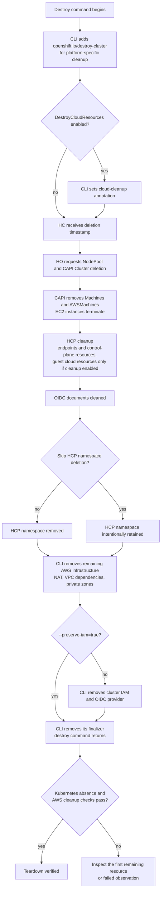
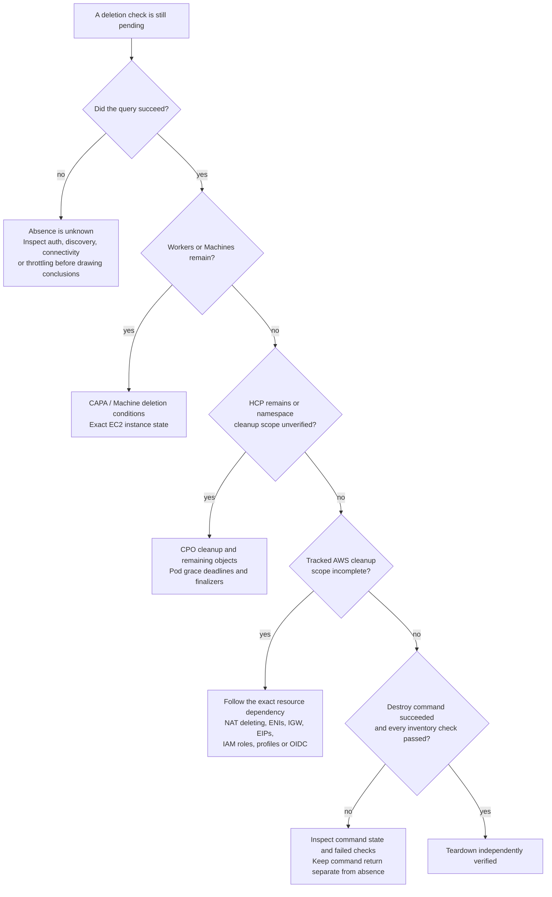

# AWS hosted cluster teardown roadmap

Startup and teardown have different completion gates. This page describes
normal AWS deletion through the HyperShift CLI, HO, CAPI, CPO, and AWS APIs.
Use it with the [startup roadmap](cluster-startup-roadmap.md) and the measured
[creation and deletion observations for two HostedClusters](cluster-startup-aws-repeat.md).

!!! note "Development timing examples only"

    The linked teardown measurements come from two AWS HostedClusters created
    and destroyed in development on the same warm management cluster. They do
    not indicate expected cleanup times for managed services such as ROSA HCP
    or ARO HCP, production deployments, Azure, or other environments. They are
    not performance benchmarks, deadlines, SLAs, or SLOs. Use the cleanup gates
    to diagnose progress and measure timing in the target environment.

## Deletion workstreams

This is a dependency model, not a strictly serial trace of every resource.
Cloud cleanup can overlap controller cleanup. The CLI finalizer keeps the HC
present while infrastructure cleanup continues, so an HC that still exists
after the HCP namespace disappears or is intentionally retained is not
automatically stuck.

The CLI sets `hypershift.openshift.io/cleanup-cloud-resources: "true"` only
when `--destroy-cloud-resources=true` (`DestroyCloudResources`) requests cleanup
of guest-created resources such as load balancers and storage disks. With
`--preserve-iam=true`, AWS cleanup skips cluster IAM and AWS OIDC provider
deletion. Record both options before deletion and verify the requested cleanup
scope; intentionally preserved IAM resources are not leaks.

The relevant code is in `cmd/cluster/core/destroy.go`,
`cmd/cluster/aws/destroy.go`,
`hypershift-operator/controllers/hostedcluster/hostedcluster_controller.go`,
and the provider and HCP deletion reconcilers. Image revisions may differ from
this checkout; record the HO and release CPO image/source revisions with each
observation.

## What to inspect next

Follow each remaining workstream when several are pending. This tree selects
evidence to inspect; it does not prescribe force deletion or finalizer removal.

| Remaining gate | Inspect first |
|----------------|---------------|
| NodePool or CAPI Machines | Inspect Machine `Deleting` conditions, AWSMachine finalizers, CAPA logs, and EC2 states. `WaitingForInfrastructureDeletion` can be normal while an instance is shutting down. |
| CAPI Cluster or AWSCluster | Remaining Machines, infrastructure conditions, provider errors and finalizers. |
| HCP | CPO cleanup conditions/logs, guest load balancers or storage, endpoint services, service and PVC finalizers. |
| HCP namespace | Namespace conditions and remaining resource finalizers; distinguish normal termination from a discovery failure. |
| NAT gateway | AWS state: `deleting` is still pending; terminal `deleted` is cleanup for this resource. |
| VPC or network dependencies | ENIs, VPC endpoints, subnets, route tables, security groups, internet gateway and Elastic IP. |
| IAM/OIDC | Inspect cluster-prefixed roles, profiles, and the exact AWS OIDC provider when IAM preservation is disabled; verify intended retention otherwise. Check the cluster's S3 key prefix separately. |
| HC with only the CLI destroy finalizer | Destroy command progress and remaining AWS infrastructure. |
| A failed query | Authentication, permissions, throttling or API connectivity; failed observation is not evidence that a resource was deleted. |

In both deletion observations, internet-gateway detachment temporarily reported
`DependencyViolation` for mapped public addresses while the NAT gateway was
still `deleting`. The normal CLI retry completed cleanup. Inspect NAT state
and remaining dependencies for progress before treating this message as a
permanent failure.

Do not remove finalizers to improve an observed timing. The normal cleanup
path is the subject of these measurements.

## Measuring teardown

Record a baseline before deletion: management-cluster context, HostedCluster
namespace/name/UID, release, HO and release CPO images, region, infrastructure
ID, worker VPC ID, and the AWS resources in scope. Start recording before the
destroy command and keep its start time, finish time, and exit code separate
from Kubernetes deletion timestamps.

During cleanup, take timestamped snapshots of HostedCluster, NodePool, HCP,
CAPI Cluster, Machine and platform-machine conditions, remaining control-plane
objects, pods, Services, PVCs, and namespace conditions. Inspect the AWS state
of the tracked VPC, networking, load balancer, IAM, and OIDC resources. Record
successful query start/end times and the first successful observation of
absence. A failed query means the state is unknown, not absent.

For pods, `deletionTimestamp` can be a future grace-period deadline rather than
the time deletion was requested. Record `deletionGracePeriodSeconds` and
`terminationGracePeriodSeconds` when available, and distinguish first observed
termination, the grace deadline, and first observed absence. A terminating
API-server pod can explain a namespace wait without a stuck finalizer.

Read namespace conditions alongside the actual remaining objects. In the
HostedCluster 2 deletion observation, conditions reported no remaining content
while terminating API-server pods and component API objects were still present.
Verify those objects directly before concluding the namespace is empty.

The AWS inventory includes worker-VPC resources and control-plane load
balancers discovered through HCP Service DNS names. Retain tracked DHCP option,
Elastic IP, worker-volume, internet-gateway, target-group, and private-zone
identities through detachment or tag changes. Query retained IDs directly;
detachment or an empty tag-filtered result does not establish deletion.

## Teardown completion

Treat teardown as verified only after the destroy command returns successfully
and successful queries confirm the absence of the HostedCluster, NodePools,
HCP, Machines, AWSMachines, CAPI/AWS clusters, control-plane components, pods,
Services, PVCs, and HCP namespace. Also verify removal of the tracked AWS
infrastructure and OIDC documents within the requested cleanup scope. Require
cluster IAM roles, profiles, and the AWS OIDC provider to be absent only when
`--preserve-iam=false`; otherwise verify and report their intended retention.
Instances in `terminated` and NAT gateways in `deleted` are terminal even if
AWS retains their records.

The namespace-absence check assumes the HC annotation
`hypershift.openshift.io/skip-delete-hosted-controlplane-namespace` was not
`"true"`. Record it before deletion. When it is `"true"`, inspect retained
objects and report the HCP namespace as intentionally retained within the
requested scope.

Use the first successful polling observation unless an API timestamp is
available. Cloud consistency and polling add uncertainty. Command return and
verified absence are separate milestones. These checks cover only the resources
inventoried for this test, not the entire AWS account. The shared HO
installation, management cluster, OIDC bucket, and base-domain hosted zone
remain in place.
