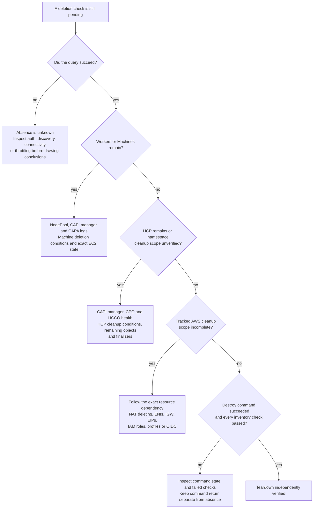

# AWS hosted cluster teardown roadmap

Startup and teardown have different completion gates. This page describes
normal AWS deletion through the HyperShift CLI, HO, CAPI, CPO, and AWS APIs.
Use it with the [startup roadmap](cluster-startup-roadmap.md) and the measured
[creation and deletion observations for two HostedClusters](cluster-startup-aws-repeat.md).

!!! note "Development timing examples only"

    The linked teardown measurements come from two AWS HostedClusters created
    and destroyed in development on the same warm management cluster. They do
    not indicate expected cleanup times for managed services such as ROSA HCP
    or ARO HCP, production deployments, Azure, or other environments. They are
    not performance benchmarks, deadlines, SLAs, or SLOs. Use the cleanup gates
    to diagnose progress and measure timing in the target environment.

## Deletion workstreams

The normal AWS CLI path preserves the control plane while worker and guest
cloud-resource cleanup still need it. A deletion request sets a timestamp;
finalizers can keep the object present until its controller finishes cleanup.

```mermaid
flowchart TD
    CMD["Destroy command begins"] --> CLI["CLI adds openshift.io/destroy-cluster<br/>to retain HC during platform cleanup"]
    CLI --> SCOPE["CLI enables guest cloud cleanup if requested<br/>An existing cleanup annotation also applies"]
    SCOPE --> HC["HC receives deletion timestamp"]
    HC --> NP["HO requests NodePool deletion first<br/>NodePool controller removes worker workloads"]
    NP --> CLUSTER["HO requests CAPI Cluster deletion"]
    CLUSTER --> WORKERS["CAPI deletes and waits for worker descendants<br/>CAPA terminates EC2 instances"]
    WORKERS --> HCP["CAPI deletes HCP through Cluster controlPlaneRef"]
    HCP --> CLOUDRES{"Guest cloud cleanup enabled<br/>and credentials valid?"}
    CLOUDRES -- yes --> GUEST["CPO scales down CVO<br/>HCCO removes guest cloud resources<br/>CPO waits for cleanup status"]
    CLOUDRES -- no --> CPCLEAN["CPO completes remaining HCP cleanup<br/>and removes its HCP finalizer"]
    GUEST --> CPCLEAN
    CPCLEAN --> INFRAREF["HCP disappears<br/>CAPI deletes infrastructure reference<br/>and finalizes CAPI Cluster"]
    INFRAREF --> GONE["HO observes CAPI Cluster absent"]
    GONE --> OIDC["HO finishes credentials, endpoints, RBAC<br/>and OIDC document cleanup"]
    OIDC --> NSCHECK{"Skip HCP namespace deletion?"}
    NSCHECK -- no --> NS["HO deletes HCP namespace<br/>and waits for absence"]
    NSCHECK -- yes --> RETAINED["HCP namespace intentionally retained"]
    NS --> HOFINAL["HO removes its HC finalizer"]
    RETAINED --> HOFINAL
    HOFINAL --> INFRA["CLI removes remaining AWS infrastructure<br/>NAT, VPC dependencies, private zones"]
    INFRA --> PRESERVE{"--preserve-iam=true?"}
    PRESERVE -- no --> IAM["CLI removes cluster IAM and OIDC provider"]
    PRESERVE -- yes --> FINAL["CLI removes its finalizer<br/>destroy command returns"]
    IAM --> FINAL
    FINAL --> CHECK{"Kubernetes absence and<br/>AWS cleanup checks pass?"}
    CHECK -- yes --> DONE["Teardown verified"]
    CHECK -- no --> INSPECT["Inspect the first remaining resource<br/>or failed observation"]
```

### Worker deletion before control-plane deletion

HO first requests deletion of the HostedCluster's NodePools. The NodePool
controller deletes its MachineDeployments or MachineSets and waits for its
Machines to disappear before removing the NodePool finalizer. CAPI and CAPA
reconcile those deletions, including terminating the worker instances.

HO then requests CAPI Cluster deletion and waits for that Cluster to disappear.
In this implementation, it does not wait for NodePool object absence before
making the Cluster deletion request. The control-plane protection comes from
CAPI: its Cluster controller waits for worker descendants, including
MachineDeployments, MachineSets, and Machines, before deleting the object
referenced by `spec.controlPlaneRef`, which is the HCP. A terminating CAPI
Cluster alongside terminating NodePools can therefore be normal.

### HCP and guest cloud-resource cleanup

CAPI requests HCP deletion; CPO performs HCP finalization. When guest cloud
cleanup is enabled and credentials are valid, CPO scales down CVO and records
`CVOScaledDown=True`. HCCO then removes guest resources that own cloud assets,
such as ingress load balancers and registry storage, and reports progress in
the HCP `CloudResourcesDestroyed` condition. CPO waits for that cleanup status
before completing its remaining cleanup and removing its HCP finalizer.

Read the condition's status, reason, and message. Depending on the deployed
revision, cleanup can be skipped or time out and allow finalization to
continue. HCP disappearance alone does not prove that every cloud resource
was removed; verify the requested cloud inventory independently.

The CAPI manager, CPO, and, for guest cleanup, HCCO must remain functional at
these gates. If one cannot run or reconcile, deletion can stop even while the
other controllers are healthy. Inspect the corresponding deployment and logs
before removing a finalizer.

### CAPI Cluster and HCP namespace cleanup

After the HCP disappears, CAPI deletes the Cluster's `AWSCluster`
infrastructure reference and completes Cluster finalization. HO waits for CAPI Cluster
absence before continuing its remaining cleanup and deleting the HCP namespace.
It also checks HCP absence before namespace deletion, including a fallback HCP
delete for paths without an operational CAPI controller.

HO cleans up remaining credentials, endpoint-service resources, RBAC, and the
cluster's OIDC document prefix. Unless namespace retention is requested, it
then deletes the HCP namespace and waits for absence before removing its HC
finalizer. The CLI finalizer can still keep the HC present after this point.

### Cleanup scope

`hypershift.openshift.io/cleanup-cloud-resources: "true"` enables cleanup of
guest-created resources such as load balancers and storage disks. It can be
set when the HostedCluster is created, including in ROSA workflows, or added
by the CLI when `--destroy-cloud-resources=true` is used. HO propagates the
annotation to HCP. Omitting the CLI flag does not clear a preexisting
annotation, so inspect the effective HC/HCP annotations as well as the command
options.

With `--preserve-iam=true`, the CLI's AWS cleanup skips cluster IAM and AWS
OIDC provider deletion. Record both options and the cleanup annotation before
deletion, then verify the requested scope. Intentionally preserved IAM
resources are not leaks.

### CLI finalizer and interrupted destroy commands

For AWS platform cleanup, the CLI adds `openshift.io/destroy-cluster` before
requesting HC deletion. This keeps the HC and its infrastructure identity
available while the CLI waits for the controllers' finalizers, then removes
remaining AWS infrastructure and, unless preserved, IAM resources. The CLI
removes its finalizer only after that work succeeds.

If the command times out, fails, or is interrupted after adding the finalizer,
the finalizer and terminating HC remain. If only this finalizer remains,
inspect the command logs and remaining AWS resources. Re-run the destroy
command with the same management context, cluster identity, and intended
cleanup options, using valid AWS credentials, to resume cleanup.

Manually removing `openshift.io/destroy-cluster` lets the HC disappear without
finishing the CLI's cleanup. Consider that only after recording the resource
identities and completing or explicitly taking responsibility for the remaining
cleanup outside the command. Removing the finalizer does not delete those AWS
resources.

The relevant code is in `cmd/cluster/core/destroy.go`,
`cmd/cluster/aws/destroy.go`,
`hypershift-operator/controllers/hostedcluster/hostedcluster_controller.go`,
`hypershift-operator/controllers/nodepool/nodepool_controller.go`,
`control-plane-operator/controllers/hostedcontrolplane/hostedcontrolplane_controller.go`,
and HCCO's `controllers/resources/resources.go`. CAPI's Cluster controller owns
the worker-descendant, control-plane-reference, and infrastructure-reference
deletion gates. Image revisions may differ from this checkout; record the HO,
CAPI, CAPA, and release CPO image/source revisions with each observation.

## What to inspect next

Follow each remaining workstream when several are pending. This tree selects
evidence to inspect; it does not prescribe force deletion or finalizer removal.

| Remaining gate | Inspect first |
|----------------|---------------|
| NodePool or CAPI Machines | Inspect NodePool finalizers, Machine `Deleting` conditions, AWSMachine finalizers, CAPI manager and CAPA logs, and EC2 states. `WaitingForInfrastructureDeletion` can be normal while an instance is shutting down. |
| CAPI Cluster or AWSCluster | Check worker descendants first, then the HCP named by `spec.controlPlaneRef`, then `spec.infrastructureRef`. Inspect CAPI manager health, deletion conditions, provider errors, and finalizers. |
| HCP | Check CPO and HCCO health and logs, `CVOScaledDown` and `CloudResourcesDestroyed` conditions, guest load balancers or storage, endpoint services, and Service/PVC finalizers. |
| HCP namespace | First verify CAPI Cluster absence; HO does not delete the namespace before that gate. If the namespace is terminating, inspect its conditions and remaining resource finalizers; distinguish normal termination from discovery failure. |
| NAT gateway | AWS state: `deleting` is still pending; terminal `deleted` is cleanup for this resource. |
| VPC or network dependencies | ENIs, VPC endpoints, subnets, route tables, security groups, internet gateway and Elastic IP. |
| IAM/OIDC | Inspect cluster-prefixed roles, profiles, and the exact AWS OIDC provider when IAM preservation is disabled; verify intended retention otherwise. Check the cluster's S3 key prefix separately. |
| HC with only the CLI destroy finalizer | Destroy command progress and remaining AWS infrastructure. If the command exited, follow the [interrupted-command recovery](#cli-finalizer-and-interrupted-destroy-commands). |
| A failed query | Authentication, permissions, throttling or API connectivity; failed observation is not evidence that a resource was deleted. |

In both deletion observations, internet-gateway detachment temporarily reported
`DependencyViolation` for mapped public addresses while the NAT gateway was
still `deleting`. The normal CLI retry completed cleanup. Inspect NAT state
and remaining dependencies for progress before treating this message as a
permanent failure.

Do not remove finalizers to improve an observed timing. The normal cleanup
path is the subject of these measurements.

## Measuring teardown

Record a baseline before deletion: management-cluster context, HostedCluster
namespace/name/UID, release, HO and release CPO images, region, infrastructure
ID, worker VPC ID, and the AWS resources in scope. Start recording before the
destroy command and keep its start time, finish time, and exit code separate
from Kubernetes deletion timestamps.

During cleanup, take timestamped snapshots of HostedCluster, NodePool, HCP,
CAPI Cluster, Machine and platform-machine conditions, remaining control-plane
objects, pods, Services, PVCs, and namespace conditions. Inspect the AWS state
of the tracked VPC, networking, load balancer, IAM, and OIDC resources. Record
successful query start/end times and the first successful observation of
absence. A failed query means the state is unknown, not absent.

For pods, `deletionTimestamp` can be a future grace-period deadline rather than
the time deletion was requested. Record `deletionGracePeriodSeconds` and
`terminationGracePeriodSeconds` when available, and distinguish first observed
termination, the grace deadline, and first observed absence. A terminating
API-server pod can explain a namespace wait without a stuck finalizer.

Read namespace conditions alongside the actual remaining objects. In the
HostedCluster 2 deletion observation, conditions reported no remaining content
while terminating API-server pods and component API objects were still present.
Verify those objects directly before concluding the namespace is empty.

The AWS inventory includes worker-VPC resources and control-plane load
balancers discovered through HCP Service DNS names. Retain tracked DHCP option,
Elastic IP, worker-volume, internet-gateway, target-group, and private-zone
identities through detachment or tag changes. Query retained IDs directly;
detachment or an empty tag-filtered result does not establish deletion.

## Teardown completion

Treat teardown as verified only after the destroy command returns successfully
and successful queries confirm the absence of the HostedCluster, NodePools,
HCP, Machines, AWSMachines, CAPI/AWS clusters, control-plane components, pods,
Services, PVCs, and HCP namespace. Also verify removal of the tracked AWS
infrastructure and OIDC documents within the requested cleanup scope. Require
cluster IAM roles, profiles, and the AWS OIDC provider to be absent only when
`--preserve-iam=false`; otherwise verify and report their intended retention.
Instances in `terminated` and NAT gateways in `deleted` are terminal even if
AWS retains their records.

The namespace-absence check assumes the HC annotation
`hypershift.openshift.io/skip-delete-hosted-controlplane-namespace` was not
`"true"`. Record it before deletion. When it is `"true"`, inspect retained
objects and report the HCP namespace as intentionally retained within the
requested scope.

Use the first successful polling observation unless an API timestamp is
available. Cloud consistency and polling add uncertainty. Command return and
verified absence are separate milestones. These checks cover only the resources
inventoried for this test, not the entire AWS account. The shared HO
installation, management cluster, OIDC bucket, and base-domain hosted zone
remain in place.
